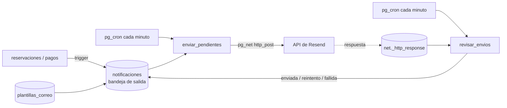

# Plan de implementación: Etapa 2

## Completar la base de datos y los correos de reservación

| Campo | Valor |
|---|---|
| Proyecto | Animayuks.shows |
| Etapa | 2 de 5 (ver diagnóstico del 4 nov 2026) |
| Estado | Propuesta para aprobar |
| Base de partida | Migraciones 1–3 aplicadas en Supabase (commit `b604b88`): 18/18 chequeos, 26/26 pruebas |
| Flujo de trabajo | El de [`supabase/README.md`](../supabase/README.md): respaldo `pg_dump` → `psql` → verificación → pruebas → commit y push |

---

## 1. Objetivo

Que la base de datos haga **todo lo que el sitio necesita para operar sin intervención manual**, antes de conectar el frontend (etapa 3):

1. Mostrar al cliente **solo horarios realmente disponibles**, calculados con la duración real del show, montaje, desmontaje y traslado de su zona.
2. **Apartar el horario 10 minutos** mientras el cliente termina de reservar, para que nadie se lo gane.
3. **Datos de pago** (transferencia) y **textos legales** editables desde el panel.
4. **Reprogramar** una reservación respetando la política.
5. **Expirar solas** las reservaciones que no pagan el anticipo a tiempo.
6. **Enviar correos de reservación** automáticamente al cliente y al dueño, con reintentos y registro de envíos.

### Qué NO incluye esta etapa

| Fuera de la etapa 2 | Dónde queda |
|---|---|
| Pantallas (calendario, subir comprobante, editor de plantillas, etc.) | Etapa 3 |
| Pagos en línea con Mercado Pago | Fase 2 del producto |
| WhatsApp automático, cupones, reseñas, reportes | Fase 2–3 del producto |
| Edge Functions | No se necesitan para esta etapa (ver decisión D2) |

---

## 2. Decisiones de arquitectura

### D1. Todo en SQL, aplicado con psql

Toda la etapa son migraciones SQL. Ventaja: se aplican con el flujo ya probado (respaldo, psql, pruebas con rollback) sin desplegar código por el dashboard, y cada cambio queda versionado en el repo.

### D2. Correos con "bandeja de salida" en la base de datos, sin Edge Function



- Un **trigger** deja el correo en la tabla `notificaciones` dentro de la misma transacción que la reservación o el pago. Si la reservación no se guarda, el correo tampoco existe.
- Un **trabajo de `pg_cron`** toma los pendientes y los manda a Resend con `pg_net`.
- Otro trabajo revisa las respuestas: marca **enviada**, programa un **reintento** con espera creciente o deja **fallida** tras 3 intentos (RNF-DIS-06).
- Las **plantillas viven en una tabla**, así el panel podrá editarlas en la etapa 3 (RF-NOT-06).
- La **API key de Resend se guarda cifrada en Supabase Vault**, nunca en el repo ni en una tabla normal.

**Alternativa descartada: Edge Function.** Sería código TypeScript, pero sin la CLI de Supabase cada cambio habría que pegarlo a mano en el dashboard. La bandeja de salida en SQL se aplica y se prueba igual que el resto.

### D3. Apartado temporal en una tabla propia con candado de agenda

- Tabla `retenciones`: un horario apartado por usuario, con vencimiento de 10 minutos (configurable).
- Para que dos personas no aparten ni reserven el mismo horario al mismo tiempo, **todas las operaciones que escriben en la agenda toman un candado** (`pg_advisory_xact_lock`): apartar, reservar, reprogramar y bloquear fechas. Son pocas operaciones por minuto, así que el candado no se nota y elimina cualquier carrera.
- La restricción `reservaciones_sin_traslape` sigue como **última defensa**.
- **Apartar exige sesión iniciada.** Así un bot no puede apartar toda la agenda, porque necesitaría cuentas, y el registro y login tienen CAPTCHA de Turnstile. En la etapa 3, el asistente pedirá iniciar sesión **antes** del paso de fecha.

### D4. Un solo cálculo de horarios para todas las funciones

Hoy `crear_reservacion()` calcula duración, bloque y zona por su cuenta. Se extrae a una función interna `calcular_horario()` que usarán **crear, apartar, reprogramar y consultar disponibilidad**. Así el calendario nunca ofrece un horario que la reservación después rechace.

Regla del flujo: `crear_reservacion()` se reconstruye **a partir de la versión viva en Supabase** (`pg_get_functiondef`), no del archivo viejo.

### D5. Turnstile solo en el login y el registro

Como reservar exige cuenta, el CAPTCHA de Supabase Auth ya protege el formulario de reservación indirectamente. No hace falta validar Turnstile en cada reservación.

**Consecuencia:** RF-AUT-12 (reservar como invitado, prioridad C) queda fuera.

---

## 3. Prerrequisitos (los haces tú)

| # | Qué | Dónde | Para qué |
|---|---|---|---|
| P1 | Crear una **segunda API key de Resend** llamada `notificaciones` (*Sending access*, dominio `animayuks.com`) | Resend → API Keys | Que los correos de reservación tengan su propia llave, separada de la del SMTP de Auth. Si una se filtra, se revoca sin tumbar la otra. |
| P2 | Agregar la llave a `supabase/.env` como `RESEND_API_KEY=re_...` | Tu editor | Yo la paso a Vault con psql sin imprimirla. **No me la pegues en el chat.** |
| P3 | **Datos bancarios** para transferencias: banco, titular y CLABE de 18 dígitos | Me los pasas o los capturas después en el panel | Se muestran al cliente en el correo y en el sitio. Mientras no lleguen, quedan como `PENDIENTE`. |
| P4 | **Correo para los avisos del dueño** (nuevas reservaciones, comprobantes) | Me lo dices | Por defecto, `picafresa.codex@gmail.com`. |
| P5 | Confirmar los **horarios de los correos automáticos** | Me lo dices | Por defecto: recordatorio al cliente a las 10:00 dos días antes, y resumen al dueño a las 20:00 con las funciones del día siguiente (hora de Guadalajara). |
| P6 | Revisar el **plan de Resend** | Resend → Billing | El plan gratuito permite 100 correos al día y 3,000 al mes. Alcanza para arrancar; hay que vigilarlo con temporada alta. |

---

## 4. Migraciones

Cada migración se aplica con el flujo completo. Pasos específicos al final de cada una.

### Migración 4: `20261104000004_configuracion_negocio.sql`

**Requerimientos:** RF-CFG-01/03/06, RF-CAT-09/10, RF-PAG-05, RNF-LEG-01.

**4.1 Columnas nuevas en `configuracion`**

| Columna | Tipo | Valor inicial | Uso |
|---|---|---|---|
| `banco` | `text` | `'PENDIENTE'` | Datos de transferencia |
| `titular_cuenta` | `text` | `'PENDIENTE'` | |
| `clabe` | `text`, check `^\d{18}$` o nulo | `null` | |
| `instrucciones_pago` | `text` | Texto base: usa tu folio como referencia… | Correo de reservación recibida y página de pago |
| `correo_avisos` | `text` | `picafresa.codex@gmail.com` | Destino de los avisos al dueño |
| `retencion_minutos` | `int` (1–60) | `10` | RN-08 |
| `intervalo_horarios_min` | `int` (15, 30 o 60) | `30` | Cada cuánto se ofrecen horarios de inicio |
| `hora_recordatorio` | `time` | `'10:00'` | Correo al cliente, 2 días antes |
| `hora_resumen_diario` | `time` | `'20:00'` | Correo al dueño |

**4.2 Tabla `paginas`** (aviso de privacidad, términos y política de cancelación)

- **Columnas:** `slug` (llave primaria: `aviso-de-privacidad`, `terminos`, `politica-de-cancelacion`), `titulo`, `contenido` (texto Markdown), `version` (entero que se incrementa con cada cambio), `publicada`, `actualizado_en`.
- **Contenido inicial:** un **borrador marcado como "BORRADOR — revisar con abogado"**, nunca vacío.
- **RLS:** lectura pública de las publicadas; escritura solo admin.
- **Trigger:** cada cambio de `contenido` incrementa `version`. Sirve para RNF-LEG-03, que exige guardar qué versión aceptó cada usuario.

**4.3 Tabla `aceptaciones_legales`** (RNF-LEG-03)

- **Columnas:** `usuario_id`, `slug`, `version`, `aceptado_en`.
- **Función `aceptar_paginas(p_slugs text[])`:** el usuario registra que aceptó la versión vigente. La usarán el registro y el asistente de reservación.
- **RLS:** cada quien ve las suyas; el admin ve todas.

**4.4 Tabla `preguntas_frecuentes`** (RF-CAT-09)

- **Columnas:** `id`, `pregunta`, `respuesta`, `orden`, `activa`.
- **Contenido inicial:** 6 preguntas de ejemplo (cuánto anticipo se paga, qué pasa si llueve, cuánto antes llegan, etc.).
- **RLS:** lectura pública de las activas; escritura solo admin.

**4.5 Seguridad de comprobantes**

- **Trigger en `pagos`:** si quien inserta no es admin, `comprobante_path` debe empezar con `<su id de usuario>/`. Evita que un cliente apunte a un archivo ajeno.

**Pruebas (`tests/02_configuracion.sql`):**

| # | Caso |
|---|---|
| C01 | Un visitante lee la configuración y las páginas publicadas, pero no las no publicadas |
| C02 | Un cliente no puede editar la configuración ni las páginas |
| C03 | Cambiar el contenido de una página incrementa su versión |
| C04 | `aceptar_paginas()` guarda la versión vigente; el cliente ve solo sus aceptaciones |
| C05 | Una CLABE inválida (17 dígitos, con letras) se rechaza |
| C06 | Un cliente no puede registrar un comprobante en una carpeta ajena |

---

### Migración 5: `20261104000005_disponibilidad.sql`

**Requerimientos:** RN-02/04/14/21, RF-DIS-01 a 04, RF-DIS-06.

**5.1 `calcular_horario()`** (interna, no expuesta)

```
calcular_horario(p_show_id, p_paquete_id, p_extras uuid[], p_codigo_postal, p_inicio)
  → (duracion_min, fin, bloque tstzrange, zona_id, traslado_min, cargo_traslado)
```

- Duración = paquete o show + minutos de extras.
- Bloque = [inicio − montaje − traslado, fin + desmontaje + traslado].
- Sin zona (fuera de cobertura) → traslado 0, zona nula. Cada función que la llame decide si eso es error.

**5.2 `validar_horario()`** (interna)

```
validar_horario(p_bloque, p_inicio, p_fin, p_excluir_reservacion uuid, p_excluir_retencion uuid)
  → text[] lista de problemas: 'anticipacion', 'fuera de horario', 'fecha bloqueada', 'ocupado'
```

- Una sola implementación de las reglas de horario, que hoy están dentro de `crear_reservacion()`.
- **"ocupado"** = traslape con reservaciones activas **o con retenciones vigentes de otros usuarios**.
- **Excluir propios:** al reprogramar se ignora la reservación propia, y al confirmar, la retención propia.

**5.3 `horarios_disponibles()`** (pública)

```
horarios_disponibles(p_show_id, p_paquete_id, p_extras uuid[], p_codigo_postal, p_fecha date)
  → table (inicio timestamptz, fin timestamptz)
```

- **Candidatos:** recorre el horario de servicio del día en pasos de `intervalo_horarios_min` y devuelve solo los inicios donde `validar_horario()` no encuentra problemas.
- **Sin cobertura:** si el código postal no tiene cobertura, devuelve vacío.
- **Privacidad:** no expone datos de clientes, por eso se permite a visitantes.

**5.4 `disponibilidad_mes()`** (pública, para pintar el calendario)

```
disponibilidad_mes(p_show_id, p_paquete_id, p_extras uuid[], p_codigo_postal, p_anio int, p_mes int)
  → table (fecha date, horarios int, estado text)   -- 'no_disponible' | 'lleno' | 'pocos' | 'libre'
```

- **`no_disponible`:** día pasado, fuera de anticipación, sin servicio o bloqueado completo.
- **`lleno`:** día con servicio pero 0 horarios libres.
- **`pocos`:** 1 o 2 horarios libres.
- **`libre`:** 3 horarios o más.

**5.5 `crear_reservacion()` reconstruida**

- **Reglas:** se sacan el cálculo de horario y las validaciones a las funciones 5.1 y 5.2; mismos mensajes de error y misma firma por ahora.
- **Candado:** toma `pg_advisory_xact_lock` de agenda antes de validar.

**Pruebas (`tests/03_disponibilidad.sql`):**

| # | Caso |
|---|---|
| D01 | Día sin reservaciones: ofrece todos los inicios que caben entre apertura y cierre |
| D02 | Un show de 60 min no se ofrece a una hora en la que terminaría después del cierre |
| D03 | Una reservación existente quita los inicios que chocan con ella **incluyendo montaje, desmontaje y traslado** |
| D04 | La misma hora libre para la zona sin traslado puede no estarlo para una zona lejana (traslado mayor) |
| D05 | Un día bloqueado devuelve vacío; un lunes sin servicio, también |
| D06 | Fechas dentro de las próximas 48 h no se ofrecen |
| D07 | Un código postal sin cobertura devuelve vacío |
| D08 | `disponibilidad_mes()` marca correctamente libre, pocos, lleno y no disponible |
| D09 | **Coherencia:** todo horario que devuelve `horarios_disponibles()` es aceptado por `crear_reservacion()`, y uno que no devuelve es rechazado |
| D10 | La batería 01 sigue pasando completa (regresión) |

---

### Migración 6: `20261104000006_retenciones.sql`

**Requerimientos:** RN-08, RF-RES-05, RF-RES-14.

**6.1 Tabla `retenciones`**

- **Columnas:** `id`, `usuario_id` (único: una por usuario), `show_id`, `paquete_id`, `extras uuid[]`, `codigo_postal`, `inicio`, `fin`, `bloque`, `expira_en`, `creado_en`.
- **RLS:** cada usuario ve la suya y el admin todas. Nadie inserta directo: solo con las funciones.

**6.2 Funciones**

| Función | Qué hace |
|---|---|
| `apartar_horario(show, paquete, extras, cp, inicio)` → `(retencion_id, expira_en)` | Exige sesión. Toma el candado, **reemplaza** la retención anterior del mismo usuario, valida con `validar_horario()` (cobertura incluida) y aparta por `retencion_minutos`. |
| `liberar_horario()` | Borra la retención del usuario, por ejemplo si regresa de paso en el asistente. |
| `crear_reservacion(…, p_retencion_id uuid default null)` | Si recibe una retención vigente del mismo usuario y con los mismos datos, la consume. Si venció pero el horario sigue libre, reserva igual. Si otro ya lo tomó, responde `HORARIO_OCUPADO`. |

- **Firma de `crear_reservacion()`:** cambia al agregar el parámetro. Se borra y se vuelve a crear, y se reaplican los permisos: `revoke` a `anon`, `grant` a `authenticated`.

**Pruebas (`tests/04_retenciones.sql`):**

| # | Caso |
|---|---|
| H01 | El cliente 1 aparta; el cliente 2 ya no ve ese horario en `horarios_disponibles()` |
| H02 | El cliente 2 no puede apartar ni reservar un horario que choca con la retención del 1 |
| H03 | El cliente 1 sí ve y puede reservar su propio horario apartado; la retención desaparece al reservar |
| H04 | Apartar otro horario reemplaza la retención anterior (una por usuario) |
| H05 | Una retención vencida ya no bloquea a nadie, aunque aún no se haya limpiado |
| H06 | Reservar con una retención vencida funciona si el horario sigue libre |
| H07 | Un visitante sin sesión no puede apartar |
| H08 | El admin ve todas las retenciones; un cliente solo la suya |

---

### Migración 7: `20261104000007_reprogramar.sql`

**Requerimientos:** RN-12, RF-MRS-04, RF-ADR-09, RF-ADR-15.

**`reprogramar_reservacion(p_reservacion_id, p_nuevo_inicio, p_motivo text default null)`**

- **Quién:** el dueño de la reservación o un admin.
- **Estado:** solo reservaciones `pendiente` o `confirmada`.
- **Reglas para el cliente:**
  - Faltan al menos `reprogramacion_min_horas` (72 h) para la fecha **actual**.
  - `reprogramaciones < reprogramaciones_max` (1).
  - La nueva fecha cumple todas las reglas de una reservación nueva.
- **Admin:** puede saltarse las reglas con `p_motivo`, que queda en `motivo_excepcion`.
- **Cálculo:** recalcula fin y bloque con los datos guardados (show, paquete, extras y zona) y el candado de agenda. Ignora la propia reservación al buscar choques.
- **Precio:** no cambia, porque aún no hay recargos por fecha.
- **Registro:** incrementa `reprogramaciones`, guarda la fecha anterior en la bitácora y dispara el correo de reprogramación (migración 9).

**Pruebas (`tests/05_reprogramar.sql`):**

| # | Caso |
|---|---|
| G01 | El cliente reprograma a un horario libre: cambian inicio, fin y bloque; el contador sube a 1 |
| G02 | Segunda reprogramación del cliente: rechazada (`REPROGRAMACION_LIMITE`) |
| G03 | A menos de 72 h del evento: rechazada (`REPROGRAMACION_TARDE`) |
| G04 | A un horario ocupado: rechazada (`HORARIO_OCUPADO`) |
| G05 | Mover la reservación 30 min dentro de su propio bloque funciona (no choca consigo misma) |
| G06 | El admin reprograma fuera de reglas con motivo; sin motivo, se rechaza |
| G07 | Otro cliente no puede reprogramar una reservación ajena |
| G08 | Una reservación cancelada no se puede reprogramar |

---

### Migración 8: `20261104000008_tareas_programadas.sql`

**Requerimientos:** RN-07, RN-08.

- **Extensión:** `create extension if not exists pg_cron`.
- **Funciones:**
  - `expirar_pendientes()`: pasa a `expirada` las reservaciones `pendiente` con `expira_en < now()`. Esto libera el horario, porque la restricción de traslape solo cuenta las pendientes y confirmadas. Devuelve cuántas expiró.
  - `limpiar_retenciones()`: borra las retenciones vencidas.
- **Trabajos de `cron`:**

| Trabajo | Frecuencia | Función |
|---|---|---|
| `ay-expirar-pendientes` | cada 10 min | `expirar_pendientes()` |
| `ay-limpiar-retenciones` | cada 5 min | `limpiar_retenciones()` |

- Los nombres llevan el prefijo `ay-` para distinguirlos.
- **Reaplicable:** `cron.schedule` con el mismo nombre reemplaza el trabajo anterior.
- **Permisos:** las funciones se revocan a `anon` y `authenticated`; solo las ejecuta `cron`.

**Pruebas (`tests/06_tareas.sql`):**

| # | Caso |
|---|---|
| X01 | Una pendiente con `expira_en` en el pasado pasa a `expirada`; una con anticipo pagado no |
| X02 | Tras expirar, el horario vuelve a aparecer en `horarios_disponibles()` |
| X03 | `limpiar_retenciones()` borra solo las vencidas |
| X04 | Los dos trabajos existen en `cron.job` y están activos |
| X05 | Un cliente no puede ejecutar `expirar_pendientes()` |

**Verificación adicional después de aplicar:** revisar `cron.job_run_details` 15 minutos después y confirmar que ambos trabajos corrieron sin error.

---

### Migración 9: `20261104000009_notificaciones.sql`

**Requerimientos:** RF-NOT-01/02/03/05/06/07, RF-PAG-09, RNF-DIS-06.

**9.1 Extensión y secreto**

- `create extension if not exists pg_net`.
- **API key en Vault:** la migración **no** contiene la llave. Paso aparte, con psql: `vault.create_secret(:'resend', 'resend_api_key')`, leyendo `RESEND_API_KEY` de `supabase/.env` sin imprimirla. Si ya existe, se actualiza con `vault.update_secret`.

**9.2 Tabla `plantillas_correo`**

- **Columnas:** `clave` (llave primaria), `destinatario` (`cliente` | `dueno`), `asunto`, `html`, `activa`, `descripcion`, `actualizado_en`.
- **Variables:** se escriben como `{{folio}}`, `{{nombre}}`, `{{show}}`, `{{paquete}}`, `{{fecha}}` ("sábado 14 de noviembre de 2026"), `{{hora}}` ("4:00 p. m."), `{{direccion}}`, `{{total}}`, `{{anticipo}}`, `{{pagado}}`, `{{saldo}}`, `{{monto}}`, `{{vence}}`, `{{reembolso}}`, `{{banco}}`, `{{titular}}`, `{{clabe}}`, `{{instrucciones_pago}}`, `{{enlace}}` (a Mis reservaciones), `{{telefono_cliente}}`, `{{lista_funciones}}` (solo en el resumen diario).
- **Diseño:** el mismo de los correos de Auth (encabezado oscuro ANIMAYUKS, botón rojo), en español.
- **RLS:** solo admin lee y edita.

| Clave | Para | Cuándo | Contenido principal |
|---|---|---|---|
| `reservacion_recibida` | Cliente | Se crea una reservación en línea pendiente | Folio, resumen, anticipo, **datos de transferencia**, vence en 24 h |
| `reservacion_confirmada` | Cliente | Pasa a `confirmada` | Confirmación, saldo pendiente, qué preparar |
| `pago_recibido` | Cliente | Se aprueba un pago | Recibo: monto, método, total pagado, saldo |
| `comprobante_rechazado` | Cliente | Un comprobante pasa de `pendiente` a `rechazado` | Motivo y cómo reenviarlo |
| `reservacion_reprogramada` | Cliente y dueño | Cambia `inicio` | Fecha anterior y fecha nueva |
| `reservacion_cancelada` | Cliente y dueño | Pasa a `cancelada` | Folio, monto reembolsable |
| `reservacion_expirada` | Cliente | Pasa a `expirada` | El horario se liberó; enlace para reservar de nuevo |
| `recordatorio` | Cliente | 2 días antes, a `hora_recordatorio` | Fecha, hora, dirección, saldo a pagar el día del evento |
| `aviso_nueva_reservacion` | Dueño | Cualquier reservación nueva, incluida la presencial | Cliente, teléfono, show, fecha, canal |
| `aviso_comprobante` | Dueño | El cliente sube un comprobante | Folio, monto; revisar en el panel |
| `resumen_diario` | Dueño | Diario, a `hora_resumen_diario`, si hay funciones mañana | Lista ordenada por hora: show, cliente, teléfono, dirección, saldo |

**9.3 Tabla `notificaciones`** (bandeja de salida y registro, RF-NOT-07)

| Columna | Tipo | Notas |
|---|---|---|
| `id` | `bigint identity` | |
| `plantilla` | `text` → `plantillas_correo` | |
| `reservacion_id`, `pago_id` | `uuid` nulos | Para evitar duplicados y rastrear |
| `destinatario` | `text` | Correo final |
| `asunto`, `html` | `text` | **Ya renderizados** al encolar: lo enviado queda tal cual en el registro |
| `estado` | `pendiente` \| `enviando` \| `enviada` \| `fallida` \| `omitida` | `omitida` = cliente sin correo (presencial) |
| `intentos` | `int` | |
| `proximo_intento` | `timestamptz` | Espera creciente: 1, 4 y 16 min |
| `request_id` | `bigint` | Id de la petición en `pg_net` |
| `respuesta`, `error` | `text` | Código y mensaje de Resend |
| `creado_en`, `enviado_en` | `timestamptz` | |

- **Índice único anti-duplicados:** (`plantilla`, `reservacion_id`, `pago_id`, `destinatario`) para los avisos que deben salir una sola vez. Así un trigger repetido o un trabajo que corre dos veces no manda el correo dos veces.
- **RLS:** solo admin lee. Nadie escribe directo.

**9.4 Funciones**

| Función | Qué hace |
|---|---|
| `fecha_es(timestamptz)` y `hora_es(timestamptz)` | Fecha y hora en español y en hora de Guadalajara, sin depender del idioma del servidor (que está en inglés) |
| `renderizar(texto, datos jsonb)` | Reemplaza `{{clave}}` por el valor **escapado para HTML**, para que un nombre como `<script>` no rompa el correo |
| `encolar_correo(plantilla, reservacion_id, pago_id, datos_extra jsonb)` | Arma los datos, renderiza asunto y HTML, decide el destinatario (cliente o `correo_avisos`), marca `omitida` si no hay correo e inserta ignorando duplicados |
| `enviar_pendientes()` | Toma hasta 10 pendientes vencidos (`for update skip locked`), lee la llave de Vault, llama `net.http_post` a `https://api.resend.com/emails` con `from: Animayuks <reservas@animayuks.com>` y `reply_to: correo_avisos`, guarda `request_id` y pasa a `enviando` |
| `revisar_envios()` | Busca las respuestas en `net._http_response`: 2xx → `enviada`; error o sin respuesta tras 5 min → reintento o `fallida` al tercer intento |
| `encolar_recordatorios()` | Encola `recordatorio` para reservaciones confirmadas cuya fecha es pasado mañana |
| `encolar_resumen_diario()` | Encola un `resumen_diario` al dueño si mañana hay funciones |
| `reintentar_correo(id)` (admin) | Devuelve una `fallida` a `pendiente`; lo usará el panel |

**9.5 Triggers**

| Tabla | Evento | Correos que encola |
|---|---|---|
| `reservaciones` | insert | `reservacion_recibida` (si es en línea y pendiente) + `aviso_nueva_reservacion` |
| `reservaciones` | update de `estado` | `confirmada` → `reservacion_confirmada`; `cancelada` → `reservacion_cancelada` (cliente y dueño); `expirada` → `reservacion_expirada` |
| `reservaciones` | update de `inicio` | `reservacion_reprogramada` (cliente y dueño) |
| `pagos` | insert `aprobado` o update a `aprobado` | `pago_recibido` |
| `pagos` | insert `pendiente` con comprobante | `aviso_comprobante` |
| `pagos` | update `pendiente` → `rechazado` | `comprobante_rechazado` |

**9.6 Trabajos de `cron`**

| Trabajo | Frecuencia (UTC) | Hora en Guadalajara |
|---|---|---|
| `ay-enviar-correos` | `* * * * *` | cada minuto |
| `ay-revisar-envios` | `* * * * *` | cada minuto |
| `ay-recordatorios` | `0 16 * * *` | 10:00 |
| `ay-resumen-diario` | `0 2 * * *` | 20:00 |

México ya no cambia de horario desde 2022, así que la diferencia con UTC es fija (−6 h).

**Pruebas (`tests/07_notificaciones.sql`)**, dentro de rollback: las peticiones de `pg_net` se deshacen y **no sale ningún correo**:

| # | Caso |
|---|---|
| N01 | Crear una reservación en línea encola `reservacion_recibida` (cliente) y `aviso_nueva_reservacion` (dueño) |
| N02 | El HTML renderizado contiene folio, fecha en español, total con formato `$2,800.00` y la CLABE |
| N03 | Un nombre con `<b>` aparece escapado (`&lt;b&gt;`) |
| N04 | Reservación presencial sin correo: el del cliente queda `omitida`, el aviso al dueño sí se encola |
| N05 | Aprobar el pago que cubre el anticipo encola `pago_recibido` y `reservacion_confirmada` |
| N06 | Cancelar encola `reservacion_cancelada` para cliente y dueño, con el monto reembolsable |
| N07 | Reprogramar encola `reservacion_reprogramada` con fecha anterior y nueva |
| N08 | Expirar encola `reservacion_expirada` |
| N09 | Ejecutar el mismo trigger dos veces no duplica correos |
| N10 | `enviar_pendientes()` pasa los pendientes a `enviando` con `request_id` |
| N11 | `revisar_envios()` con respuesta 200 simulada → `enviada`; con 422 → reintento con `proximo_intento`; al tercer fallo → `fallida` |
| N12 | `encolar_recordatorios()` solo toma confirmadas de pasado mañana; `encolar_resumen_diario()` lista las funciones de mañana en orden |
| N13 | Un cliente no puede leer `notificaciones` ni `plantillas_correo`, ni ejecutar `enviar_pendientes()` |

**Prueba real controlada (una sola vez, con tu permiso):** crear una reservación de prueba a nombre del admin, ver llegar a `picafresa.codex@gmail.com` los correos de *recibida* y *aviso al dueño*, revisar que se vean bien en Gmail en computadora y celular, y luego cancelarla. Esa reservación de prueba sí queda en la base, marcada como cancelada.

---

## 5. Actualizar la verificación

`supabase/verificacion.sql` crece con chequeos nuevos:

- Tablas nuevas existen y tienen RLS: `paginas`, `aceptaciones_legales`, `preguntas_frecuentes`, `retenciones`, `plantillas_correo`, `notificaciones` (16 → 22).
- Funciones nuevas existen.
- Extensiones `pg_cron` y `pg_net` instaladas.
- Los 6 trabajos `ay-*` existen y están activos.
- El secreto `resend_api_key` existe en Vault (solo se revisa que exista, sin leerlo).
- Las 11 plantillas existen y están activas.

---

## 6. Orden de ejecución

Cada fila es una vuelta completa del flujo: respaldo → aplicar → verificación → **todas** las baterías (incluidas las anteriores) → commit y push.

| # | Paso | Depende de | Prerrequisito tuyo |
|---|---|---|---|
| 1 | Migración 4: configuración, páginas, FAQ, comprobantes | — | P3 opcional (puede quedar `PENDIENTE`) |
| 2 | Migración 5: disponibilidad y `crear_reservacion` reconstruida | 1 | — |
| 3 | Migración 6: retenciones | 2 | — |
| 4 | Migración 7: reprogramar | 2 | — |
| 5 | Migración 8: tareas programadas | 3 | — |
| 6 | Migración 9: notificaciones + secreto en Vault | 1–5 | **P1, P2, P4, P5** |
| 7 | Prueba real controlada de correos | 6 | Tu permiso |
| 8 | Revisión de seguridad (Security Advisor) y documentación | 7 | Captura del Advisor |

**Si cualquier batería falla, se corrige antes de seguir.** Ninguna migración nueva se aplica sobre una base que no pasa todas las pruebas anteriores.

---

## 7. Criterios de terminado

La etapa 2 está terminada cuando:

- [ ] Las migraciones 4 a 9 están aplicadas en Supabase, en el repo y con respaldo previo a cada una en `respaldos/`.
- [ ] `verificacion.sql` pasa completo.
- [ ] Las baterías 01 a 07 pasan en Supabase sin dejar datos (más de 80 pruebas).
- [ ] Los trabajos de `cron` corrieron al menos una vez sin error (`cron.job_run_details`).
- [ ] La prueba real de correos llegó a la bandeja de entrada (no a spam) y se ve bien en celular.
- [ ] El Security Advisor no tiene avisos críticos sin explicar.
- [ ] `supabase/README.md` documenta las funciones públicas que usará el frontend: firma, parámetros, errores posibles y ejemplo de llamada desde `supabase-js`.

---

## 8. Riesgos y cómo se mitigan

| Riesgo | Impacto | Mitigación |
|---|---|---|
| `pg_net` no entrega o Resend responde con error | Correos que no llegan | Reintentos con espera creciente, estado `fallida` visible y `reintentar_correo()` para el panel |
| Límite del plan gratuito de Resend (100/día) | Correos que no salen en días de mucho movimiento | Unos 4–6 correos por reservación: alcanza para unas 20 reservaciones al día. Vigilar en Resend → Usage |
| Fechas en inglés porque el servidor está en inglés | Correos con "Saturday" | `fecha_es()` con nombres de días y meses propios (prueba N02) |
| Diferencias entre el calendario y lo que acepta la reservación | Cliente elige un horario y le sale "ocupado" | Un solo cálculo (`calcular_horario` y `validar_horario`) y la prueba de coherencia D09 |
| Alguien aparta todos los horarios | Agenda bloqueada | Una retención por usuario, cuentas con CAPTCHA, vencimiento de 10 min y limpieza cada 5 min |
| Proyecto gratuito de Supabase pausado por inactividad | `cron` deja de correr; reservaciones sin expirar y correos sin enviar | **Decidir el plan Pro antes de lanzar** (pendiente de la etapa 1) |
| Cambiar la firma de `crear_reservacion()` | El frontend llama con la firma vieja | Parámetro nuevo con valor por defecto; el frontend aún no la usa |
| Datos bancarios incorrectos | Pagos a una cuenta equivocada | Validación de CLABE de 18 dígitos y revisión de los datos con el dueño antes de lanzar |

---

## 9. Trazabilidad

| Requerimiento | Cubierto por |
|---|---|
| RN-02 Sin traslapes con montaje, desmontaje y traslado | M5 (`calcular_horario`, `validar_horario`), candado de agenda, restricción existente |
| RN-04 Anticipación mínima y máxima | M5 `validar_horario` |
| RN-07 Expiración de pendientes | M8 `expirar_pendientes` |
| RN-08 Retención temporal | M6 `retenciones`, M8 `limpiar_retenciones` |
| RN-12 Reprogramación | M7 `reprogramar_reservacion` |
| RN-14 Fechas bloqueadas | M5 `validar_horario` |
| RN-21 Horario de servicio | M5 `horarios_disponibles` |
| RF-DIS-01 a 04 Calendario y horarios disponibles | M5 |
| RF-RES-05, RF-RES-14 Apartar y evitar duplicados | M6 |
| RF-MRS-04 Reprogramar (cliente) | M7 |
| RF-PAG-05 Comprobante de transferencia | M4 (datos bancarios y validación de ruta), M9 (`aviso_comprobante`) |
| RF-PAG-09 Recibo por pago | M9 `pago_recibido` |
| RF-NOT-01/03 Correos al cliente y al dueño | M9 |
| RF-NOT-02 Recordatorios | M9 `encolar_recordatorios` |
| RF-NOT-05 Resumen diario | M9 `encolar_resumen_diario` |
| RF-NOT-06 Plantillas editables | M9 `plantillas_correo` |
| RF-NOT-07 Registro de envíos | M9 `notificaciones` |
| RF-CAT-09/10, RF-CFG-06 FAQ y textos legales | M4 |
| RNF-LEG-01/03 Aviso de privacidad y versión aceptada | M4 `paginas`, `aceptaciones_legales` |
| RNF-DIS-06 Reintentos | M9 `revisar_envios` |
