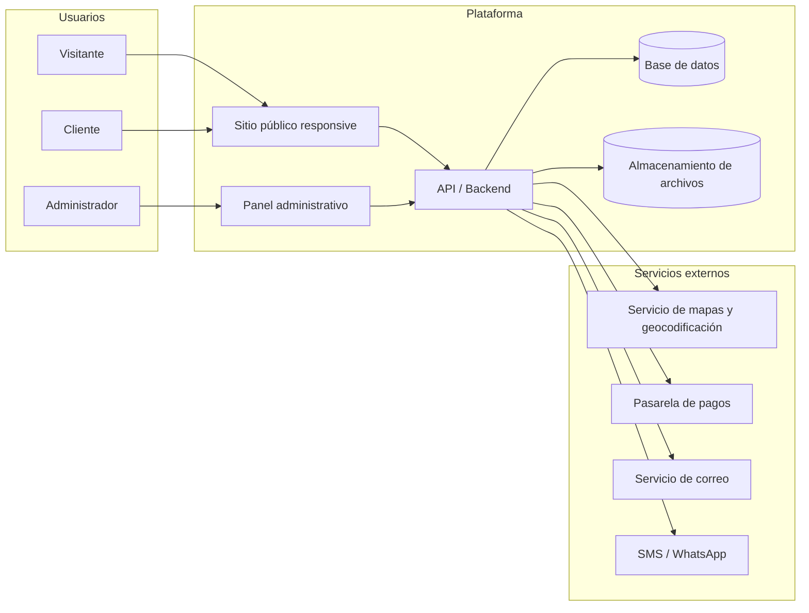
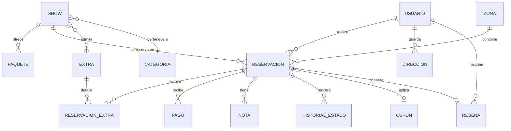
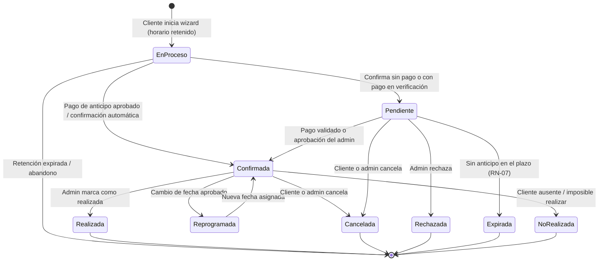

# Especificación de Requerimientos de Software (ERS)

## Sistema Web de Reservación de Shows

| Campo | Valor |
|---|---|
| **Proyecto** | Plataforma Web de Reservación de Shows |
| **Documento** | Especificación de Requerimientos de Software (ERS / SRS) |
| **Versión** | 1.0 |
| **Estado** | Borrador para revisión con el cliente |
| **Fecha** | 28 de octubre de 2026 |
| **Estándar de referencia** | ISO/IEC/IEEE 29148:2018 (sucesor de IEEE 830) |
| **Clasificación** | Confidencial – Uso interno del proyecto |

### Historial de versiones

| Versión | Fecha | Autor | Descripción del cambio |
|---|---|---|---|
| 1.0 | 2026-10-28 | Equipo de desarrollo | Versión inicial del documento de requerimientos |

### Aprobaciones

| Rol | Nombre | Firma | Fecha |
|---|---|---|---|
| Cliente / Propietario del producto | | | |
| Líder técnico | | | |
| Responsable de QA | | | |

---

## Tabla de contenido

1. [Introducción](#1-introducción)
2. [Descripción general del sistema](#2-descripción-general-del-sistema)
3. [Actores, roles y permisos](#3-actores-roles-y-permisos)
4. [Reglas de negocio](#4-reglas-de-negocio)
5. [Requerimientos funcionales](#5-requerimientos-funcionales)
6. [Requerimientos no funcionales](#6-requerimientos-no-funcionales)
7. [Requerimientos de datos](#7-requerimientos-de-datos)
8. [Requerimientos de interfaces externas](#8-requerimientos-de-interfaces-externas)
9. [Casos de uso principales](#9-casos-de-uso-principales)
10. [Ciclo de vida de una reservación](#10-ciclo-de-vida-de-una-reservación)
11. [Mapa del sitio (estructura de pantallas)](#11-mapa-del-sitio-estructura-de-pantallas)
12. [Priorización y alcance por fases](#12-priorización-y-alcance-por-fases)
13. [Matriz de trazabilidad](#13-matriz-de-trazabilidad)
14. [Supuestos, restricciones y dependencias](#14-supuestos-restricciones-y-dependencias)
15. [Riesgos identificados](#15-riesgos-identificados)
16. [Preguntas abiertas para el cliente](#16-preguntas-abiertas-para-el-cliente)
17. [Glosario](#17-glosario)

---

## 1. Introducción

### 1.1 Propósito

Este documento define de forma completa, verificable y priorizada los requerimientos funcionales y no funcionales de la **Plataforma Web de Reservación de Shows**. Su objetivo es servir como acuerdo formal entre el cliente y el equipo de desarrollo, y como base para las etapas de diseño, implementación, pruebas y aceptación.

Está dirigido a:

- **Cliente / propietario de los shows:** para validar que el sistema cubre las necesidades del negocio.
- **Equipo de desarrollo (frontend, backend, DevOps):** como referencia de construcción.
- **Equipo de QA:** para derivar casos de prueba a partir de los criterios de aceptación.
- **Diseñadores UX/UI:** para conocer los flujos y restricciones de interfaz.

### 1.2 Alcance del producto

El sistema es una aplicación web compuesta por dos grandes módulos:

1. **Sitio público (portal del cliente):** página responsive donde cualquier persona puede conocer el catálogo de shows, verificar si su ubicación se encuentra dentro de la zona de cobertura, consultar disponibilidad en tiempo real y realizar una reservación a distancia.
2. **Panel administrativo:** espacio privado para el dueño de los shows, desde el cual gestiona su agenda, el catálogo de shows, las zonas de cobertura, los clientes y las reservaciones (incluyendo las que llegan de forma presencial o telefónica), además de consultar reportes del negocio.

**Restricción central de negocio:** el servicio es **exclusivamente local**. El sistema debe validar la ubicación del evento y **impedir reservaciones fuera de la zona de cobertura** definida por el administrador.

**Beneficios esperados:**

- Reducir el tiempo de gestión manual de reservaciones (llamadas, mensajes, libretas).
- Eliminar dobles reservaciones mediante una agenda única y centralizada.
- Ampliar el alcance comercial con un canal de reservación disponible 24/7.
- Contar con información estructurada de clientes e ingresos para la toma de decisiones.

**Fuera de alcance (versión 1.0):**

- Aplicaciones móviles nativas (iOS/Android). El sitio será responsive y opcionalmente instalable como PWA.
- Marketplace multi-proveedor (varios dueños de shows independientes).
- Venta de boletos para eventos públicos con asientos numerados.
- Facturación electrónica (CFDI) integrada — se contempla como fase futura.

### 1.3 Definiciones y convenciones del documento

- **Identificadores:** `RF-XXX-NN` para requerimientos funcionales, `RNF-XXX-NN` para no funcionales, `RN-NN` para reglas de negocio, `CU-NN` para casos de uso.
- **Prioridad (MoSCoW):**
  - **Must (M):** imprescindible para la primera versión.
  - **Should (S):** importante, se incluye si el plan lo permite.
  - **Could (C):** deseable, valor agregado.
  - **Won't (W):** no se incluye en esta versión; se documenta para el futuro.
- **Palabras clave:** "**debe**" indica obligatoriedad; "**debería**" indica recomendación; "**podrá**" indica opcionalidad.

Las definiciones de términos de negocio se encuentran en la sección [17. Glosario](#17-glosario).

### 1.4 Referencias

- ISO/IEC/IEEE 29148:2018 – Systems and software engineering — Life cycle processes — Requirements engineering.
- ISO/IEC 25010:2023 – Modelo de calidad del producto de software.
- WCAG 2.2 – Web Content Accessibility Guidelines (W3C).
- OWASP Top 10 (2021) y OWASP ASVS 4.0.
- Ley Federal de Protección de Datos Personales en Posesión de los Particulares (LFPDPPP) – México.
- Ley Federal de Protección al Consumidor (LFPC) – México.

---

## 2. Descripción general del sistema

### 2.1 Perspectiva del producto

El sistema es un producto nuevo e independiente. Sustituye procesos manuales (agenda en papel, WhatsApp, hojas de cálculo). Se compone de:



### 2.2 Funciones principales del producto (resumen)

| # | Función | Módulo |
|---|---|---|
| 1 | Registro, inicio de sesión y gestión de perfil | Público / Admin |
| 2 | Catálogo de shows con fotos, videos, precios y paquetes | Público |
| 3 | Validación de cobertura geográfica de la dirección del evento | Público / Admin |
| 4 | Consulta de disponibilidad en calendario | Público |
| 5 | Proceso de reservación guiado (wizard) | Público |
| 6 | Pago de anticipo / pago total en línea (opcional según configuración) | Público |
| 7 | Gestión de "Mis reservaciones" (ver, reprogramar, cancelar) | Público |
| 8 | Notificaciones por correo / SMS / WhatsApp | Transversal |
| 9 | Dashboard con indicadores clave | Admin |
| 10 | Agenda de shows (vistas día / semana / mes / lista) | Admin |
| 11 | Registro manual de reservaciones (clientes presenciales) | Admin |
| 12 | Gestión del catálogo de shows, paquetes y extras | Admin |
| 13 | Gestión de zonas de cobertura y tarifas de traslado | Admin |
| 14 | Gestión de clientes (CRM básico) | Admin |
| 15 | Control de pagos y saldos | Admin |
| 16 | Bloqueo de fechas y configuración de horarios | Admin |
| 17 | Reportes y exportación | Admin |
| 18 | Configuración general y políticas del negocio | Admin |
| 19 | Bitácora de auditoría | Admin |

### 2.3 Características de los usuarios

| Tipo de usuario | Descripción | Nivel técnico esperado | Dispositivo predominante |
|---|---|---|---|
| Visitante | Persona que navega el sitio sin cuenta | Bajo a medio | Teléfono móvil |
| Cliente | Persona registrada que reserva un show para un evento (fiesta, boda, evento corporativo, etc.) | Bajo a medio | Teléfono móvil (≈70–80 %) |
| Administrador | Dueño de los shows; gestiona agenda, clientes y catálogo | Medio | Computadora y teléfono |

### 2.4 Entorno operativo

- **Navegadores soportados:** las dos últimas versiones estables de Chrome, Edge, Firefox y Safari (escritorio y móvil), además de Samsung Internet.
- **Dispositivos:** teléfonos (desde 360 px de ancho), tabletas y computadoras de escritorio.
- **Hospedaje:** infraestructura en la nube con HTTPS obligatorio.
- **Zona horaria por defecto:** `America/Mexico_City` (configurable).
- **Idioma:** español (México). Arquitectura preparada para internacionalización (i18n).
- **Moneda:** peso mexicano (MXN), configurable.

---

## 3. Actores, roles y permisos

### 3.1 Actores

| Actor | Tipo | Descripción |
|---|---|---|
| **Visitante** | Humano, no autenticado | Navega el catálogo, verifica cobertura y consulta disponibilidad. Debe registrarse o iniciar sesión para reservar. |
| **Cliente** | Humano, autenticado | Usuario común. Reserva, paga, consulta, reprograma y cancela sus reservaciones; administra su perfil. |
| **Administrador** | Humano, autenticado | Dueño de los shows. Acceso total al panel administrativo. |
| **Sistema (tareas programadas)** | No humano | Envía recordatorios, expira reservaciones pendientes, genera respaldos. |
| **Pasarela de pago** | Sistema externo | Procesa cobros y notifica resultados vía webhooks. |
| **Servicio de mapas** | Sistema externo | Geocodifica direcciones y calcula distancias. |

> **Nota de extensibilidad:** aunque el alcance actual define dos roles (cliente y administrador), el modelo de permisos debe diseñarse basado en roles (RBAC) para poder agregar en el futuro roles como *Asistente* o *Staff/Artista* sin reestructurar el sistema.

### 3.2 Matriz de permisos

| Funcionalidad | Visitante | Cliente | Administrador |
|---|:---:|:---:|:---:|
| Ver catálogo de shows y detalle | ✅ | ✅ | ✅ |
| Verificar cobertura de una dirección | ✅ | ✅ | ✅ |
| Consultar disponibilidad del calendario | ✅ | ✅ | ✅ |
| Registrarse / iniciar sesión | ✅ | — | ✅ (solo login) |
| Crear reservación en línea | ❌ | ✅ | ✅ (a nombre de un cliente) |
| Pagar en línea | ❌ | ✅ | ❌ |
| Ver / cancelar / reprogramar reservaciones propias | ❌ | ✅ | ✅ (todas) |
| Dejar reseña de un show realizado | ❌ | ✅ | ❌ (solo moderar) |
| Acceder al panel administrativo | ❌ | ❌ | ✅ |
| Gestionar agenda, bloqueos y horarios | ❌ | ❌ | ✅ |
| Gestionar catálogo, paquetes y extras | ❌ | ❌ | ✅ |
| Gestionar zonas de cobertura | ❌ | ❌ | ✅ |
| Ver datos de todos los clientes | ❌ | ❌ | ✅ |
| Registrar pagos manuales | ❌ | ❌ | ✅ |
| Ver reportes y exportar | ❌ | ❌ | ✅ |
| Configuración general del sistema | ❌ | ❌ | ✅ |
| Ver bitácora de auditoría | ❌ | ❌ | ✅ |

---

## 4. Reglas de negocio

Las reglas de negocio son políticas que el sistema debe hacer cumplir. Los valores marcados como *(configurable)* deben poder modificarse desde el panel administrativo sin cambios de código.

| ID | Regla |
|---|---|
| **RN-01** | Solo se aceptan reservaciones cuya dirección del evento se encuentre **dentro de una zona de cobertura activa**. |
| **RN-02** | Un mismo horario no puede tener dos reservaciones que se traslapen, considerando la duración del show **más** el tiempo de montaje, desmontaje y traslado *(configurable)*. |
| **RN-03** | La capacidad simultánea por defecto es de **1 show a la vez** *(configurable: el admin puede permitir N shows simultáneos si cuenta con más de un equipo)*. |
| **RN-04** | Una reservación en línea debe hacerse con una anticipación mínima de **48 horas** *(configurable)* y como máximo **12 meses** antes *(configurable)*. |
| **RN-05** | Las reservaciones en línea quedan en estado **Pendiente** hasta que se confirme el pago del anticipo o el administrador las apruebe manualmente, según el modo configurado. |
| **RN-06** | El anticipo requerido es del **30 %** del total *(configurable: porcentaje o monto fijo; puede ser 0 %)*. |
| **RN-07** | Una reservación Pendiente sin anticipo se libera automáticamente tras **24 horas** *(configurable)*, devolviendo el horario a disponible. |
| **RN-08** | Durante el proceso de reservación, el horario seleccionado se **bloquea temporalmente por 10 minutos** *(configurable)* para evitar que otro usuario lo tome. |
| **RN-09** | El precio total = precio del show/paquete + extras + cargo por zona/traslado + recargos aplicables (día festivo, horario nocturno) − descuentos (cupones). |
| **RN-10** | Las zonas pueden tener un **cargo de traslado** fijo o por kilómetro *(configurable por zona)*. |
| **RN-11** | La política de cancelación por defecto: cancelación con ≥ 7 días de anticipación → reembolso del anticipo menos comisión; < 7 días → el anticipo no es reembolsable *(configurable por tramos)*. |
| **RN-12** | Un cliente puede **reprogramar** una reservación confirmada como máximo **1 vez** y con al menos **72 horas** de anticipación *(configurable)*, sujeto a disponibilidad. |
| **RN-13** | El administrador puede crear reservaciones **sin restricción de anticipación mínima** ni de cobertura (con advertencia visible y registro en la bitácora). |
| **RN-14** | Las fechas bloqueadas por el administrador (vacaciones, mantenimiento, días personales) no se muestran como disponibles. |
| **RN-15** | Solo un cliente con una reservación en estado **Realizada** puede dejar una reseña de ese show, una sola vez por reservación. |
| **RN-16** | Cada reservación tiene un **folio único**, legible y no secuencial predecible (ej. `SHW-2026-7K4Q9`). |
| **RN-17** | Los precios se muestran con impuestos incluidos o desglosados según configuración fiscal *(configurable)*. |
| **RN-18** | Un show inactivo/oculto no puede reservarse en línea, pero sus reservaciones existentes se conservan. |
| **RN-19** | No se puede eliminar físicamente un show, zona o cliente que tenga reservaciones asociadas; solo desactivar (borrado lógico). |
| **RN-20** | El correo electrónico es único por cuenta de usuario. |
| **RN-21** | El horario de servicio por defecto es de 09:00 a 23:00 *(configurable por día de la semana)*. |

---

## 5. Requerimientos funcionales

Cada requerimiento incluye: identificador, descripción, prioridad y, cuando aplica, criterios de aceptación (CA).

### 5.1 Módulo de Autenticación y Cuentas (AUT)

| ID | Requerimiento | Prioridad |
|---|---|:---:|
| **RF-AUT-01** | El sistema debe permitir el **registro de clientes** con: nombre(s), apellidos, correo electrónico, teléfono celular, contraseña y aceptación del aviso de privacidad y términos y condiciones. | M |
| **RF-AUT-02** | El sistema debe **verificar el correo electrónico** mediante un enlace o código de un solo uso con vigencia de 24 horas. | M |
| **RF-AUT-03** | El sistema debe permitir **iniciar sesión** con correo y contraseña. | M |
| **RF-AUT-04** | El sistema debería permitir iniciar sesión con **proveedores externos** (Google, Apple, Facebook). | S |
| **RF-AUT-05** | El sistema debe permitir la **recuperación de contraseña** mediante un enlace temporal (vigencia 1 hora, uso único). | M |
| **RF-AUT-06** | El sistema debe permitir **cerrar sesión** en el dispositivo actual y, opcionalmente, en todos los dispositivos. | M |
| **RF-AUT-07** | El sistema debe permitir al usuario **cambiar su contraseña** proporcionando la contraseña actual. | M |
| **RF-AUT-08** | El sistema debe **bloquear temporalmente** la cuenta tras 5 intentos fallidos de inicio de sesión en 15 minutos. | M |
| **RF-AUT-09** | El administrador debe contar con **autenticación de dos factores (2FA)** mediante aplicación TOTP o código por correo. | S |
| **RF-AUT-10** | El sistema debe permitir al cliente **eliminar su cuenta** (derecho de cancelación ARCO), anonimizando sus datos personales pero conservando registros contables requeridos. | M |
| **RF-AUT-11** | El sistema debe permitir la opción **"Recordarme"** en el inicio de sesión. | S |
| **RF-AUT-12** | El sistema podrá permitir una reservación como **invitado** (sin cuenta), creando automáticamente una cuenta ligada al correo para su posterior activación. | C |
| **RF-AUT-13** | El acceso al panel administrativo debe estar en una ruta separada y restringido exclusivamente al rol administrador. | M |

**Criterios de aceptación (RF-AUT-01):**
- CA1: Si el correo ya existe, se muestra "Este correo ya está registrado" y un enlace a iniciar sesión / recuperar contraseña.
- CA2: La contraseña debe cumplir la política definida en RNF-SEG-03; los errores se indican en línea, campo por campo.
- CA3: No se permite completar el registro sin aceptar el aviso de privacidad.
- CA4: Al registrarse, se envía el correo de verificación en menos de 1 minuto.

### 5.2 Módulo de Perfil del Cliente (PER)

| ID | Requerimiento | Prioridad |
|---|---|:---:|
| **RF-PER-01** | El cliente debe poder **ver y editar** sus datos personales (nombre, teléfono, foto opcional). | M |
| **RF-PER-02** | El cliente debe poder **guardar direcciones** frecuentes (libreta de direcciones) con alias (ej. "Casa", "Salón X"), validando cobertura al guardarlas. | S |
| **RF-PER-03** | El cliente debe poder configurar sus **preferencias de notificación** (correo, SMS, WhatsApp). | S |
| **RF-PER-04** | El cliente debe poder **descargar sus datos personales** en formato legible (derecho de acceso ARCO). | S |
| **RF-PER-05** | El cambio de correo electrónico debe requerir verificación del nuevo correo. | M |

### 5.3 Módulo Sitio Público y Catálogo (CAT)

| ID | Requerimiento | Prioridad |
|---|---|:---:|
| **RF-CAT-01** | El sistema debe mostrar una **página de inicio** con: presentación del negocio, shows destacados, llamada a la acción "Reservar", verificador rápido de cobertura, testimonios y datos de contacto. | M |
| **RF-CAT-02** | El sistema debe mostrar un **catálogo de shows** en formato de tarjetas con imagen, nombre, descripción breve, duración, precio "desde" y calificación promedio. | M |
| **RF-CAT-03** | El sistema debe permitir **filtrar** el catálogo por categoría/tipo de evento (infantil, boda, XV años, corporativo, etc.), rango de precio, duración y disponibilidad en una fecha. | S |
| **RF-CAT-04** | El sistema debe permitir **buscar** shows por texto. | S |
| **RF-CAT-05** | El sistema debe mostrar la **página de detalle del show** con: galería de fotos, video (YouTube/Vimeo o propio), descripción completa, duración, número de artistas, requisitos técnicos (espacio, toma de corriente, etc.), paquetes, extras, precio, política de cancelación y reseñas. | M |
| **RF-CAT-06** | El sistema debe mostrar los **paquetes** de cada show (ej. Básico, Plus, Premium) con su comparación de características. | S |
| **RF-CAT-07** | El sistema debe mostrar los **extras** disponibles (ej. tiempo adicional, pastel, fotografía, sonido) con su precio. | S |
| **RF-CAT-08** | El sistema debe mostrar un **mapa de cobertura** con las zonas donde se ofrece el servicio. | M |
| **RF-CAT-09** | El sistema debe incluir una sección de **Preguntas Frecuentes (FAQ)** administrable. | S |
| **RF-CAT-10** | El sistema debe incluir páginas de **Aviso de privacidad**, **Términos y condiciones** y **Política de cancelación**, editables desde el panel. | M |
| **RF-CAT-11** | El sistema debe incluir un **formulario de contacto** y botón flotante de **WhatsApp** directo al negocio. | S |
| **RF-CAT-12** | El sistema debe mostrar **reseñas y calificaciones** de clientes aprobadas por el administrador. | C |
| **RF-CAT-13** | El sistema debería permitir **compartir** un show en redes sociales (Open Graph / enlaces de compartir). | C |
| **RF-CAT-14** | El sistema podrá mostrar un **cotizador rápido** que estime el precio sin necesidad de iniciar sesión, según show, paquete, extras y código postal. | S |

### 5.4 Módulo de Cobertura Geográfica (COB)

Este módulo implementa la restricción de **reservaciones únicamente locales**.

| ID | Requerimiento | Prioridad |
|---|---|:---:|
| **RF-COB-01** | El administrador debe poder **definir zonas de cobertura** mediante al menos uno de los siguientes métodos: (a) lista de **códigos postales**, (b) lista de **municipios/alcaldías/colonias**, (c) **radio en kilómetros** desde una ubicación base, (d) **polígono dibujado** sobre un mapa. | M (a, b, c) / S (d) |
| **RF-COB-02** | Cada zona debe tener: nombre, color identificador en mapa, estado (activa/inactiva), cargo de traslado (fijo, por km o sin costo), tiempo estimado de traslado y notas internas. | M |
| **RF-COB-03** | El sistema debe permitir **zonas de exclusión** (áreas dentro de un radio donde no se presta servicio). | S |
| **RF-COB-04** | El visitante debe poder **verificar la cobertura** ingresando código postal o dirección completa, antes de iniciar la reservación. | M |
| **RF-COB-05** | El sistema debe ofrecer **autocompletado de direcciones** y la opción de **"Usar mi ubicación actual"** (geolocalización del navegador con consentimiento). | S |
| **RF-COB-06** | El sistema debe **geocodificar** la dirección del evento (obtener latitud/longitud) y determinar a qué zona pertenece. | M |
| **RF-COB-07** | Si la dirección **está fuera de cobertura**, el sistema debe bloquear la reservación, mostrar un mensaje claro ("Por el momento no damos servicio en tu zona"), mostrar el mapa de cobertura y ofrecer **dejar sus datos en lista de interés** o contactar por WhatsApp. | M |
| **RF-COB-08** | La validación de cobertura debe ejecutarse **tanto en el cliente como en el servidor**; la validación del servidor es la que rige. | M |
| **RF-COB-09** | El sistema debe permitir al cliente **ajustar el pin** en el mapa cuando la geocodificación sea imprecisa. | S |
| **RF-COB-10** | El sistema debe calcular y mostrar el **cargo de traslado** correspondiente a la zona antes de confirmar. | M |
| **RF-COB-11** | El administrador debe poder **probar una dirección** desde el panel para saber en qué zona cae. | S |
| **RF-COB-12** | El sistema debe registrar las **búsquedas fuera de cobertura** (código postal / municipio, sin datos personales salvo consentimiento) para un reporte de demanda potencial. | C |
| **RF-COB-13** | El administrador podrá definir **zonas con disponibilidad restringida** (ej. una zona lejana solo disponible sábados y domingos). | C |

**Criterios de aceptación (RF-COB-07):**
- CA1: Con una dirección fuera de todas las zonas activas, el botón "Continuar" permanece deshabilitado y la API rechaza la creación de la reservación con un error de validación.
- CA2: El mensaje se muestra en menos de 2 segundos tras ingresar la dirección.
- CA3: Si el visitante deja sus datos en la lista de interés, el registro aparece en el panel del administrador.

### 5.5 Módulo de Disponibilidad y Calendario Público (DIS)

| ID | Requerimiento | Prioridad |
|---|---|:---:|
| **RF-DIS-01** | El sistema debe mostrar un **calendario mensual** indicando por color los días: disponible, pocos horarios, lleno y no disponible. | M |
| **RF-DIS-02** | Al seleccionar un día, el sistema debe mostrar los **horarios de inicio disponibles**, calculados según duración del show, tiempos de montaje/traslado, horario de servicio y reservaciones existentes. | M |
| **RF-DIS-03** | La disponibilidad debe reflejar **en tiempo real** los cambios (nuevas reservaciones, bloqueos del admin). | M |
| **RF-DIS-04** | El sistema debe respetar la anticipación mínima y máxima (RN-04) al mostrar fechas. | M |
| **RF-DIS-05** | El sistema debería considerar el **tiempo de traslado entre zonas** al calcular horarios contiguos. | C |
| **RF-DIS-06** | El sistema debe mostrar las horas en la **zona horaria del negocio**, indicándola explícitamente. | M |
| **RF-DIS-07** | El sistema podrá ofrecer una **lista de espera** para fechas llenas, notificando al cliente si se libera un horario. | C |

### 5.6 Módulo de Reservación en Línea (RES)

El proceso de reservación debe presentarse como un **asistente por pasos (wizard)** con indicador de progreso:

1. Selección del show y paquete
2. Ubicación del evento (validación de cobertura)
3. Fecha y hora
4. Extras y detalles del evento
5. Datos de contacto
6. Resumen y pago / confirmación

| ID | Requerimiento | Prioridad |
|---|---|:---:|
| **RF-RES-01** | El cliente debe poder **seleccionar un show y paquete** para iniciar la reservación. | M |
| **RF-RES-02** | El cliente debe capturar la **dirección del evento**: calle, número exterior/interior, colonia, código postal, municipio, estado, referencias y ubicación en mapa. | M |
| **RF-RES-03** | El sistema debe **validar la cobertura** (RF-COB-06/07) antes de permitir avanzar. | M |
| **RF-RES-04** | El cliente debe **seleccionar fecha y hora** de inicio entre los horarios disponibles. | M |
| **RF-RES-05** | Al elegir el horario, el sistema debe **retenerlo temporalmente** (RN-08) mostrando un contador regresivo. | M |
| **RF-RES-06** | El cliente debe poder agregar **extras** y ver el total actualizado en tiempo real. | S |
| **RF-RES-07** | El cliente debe capturar **detalles del evento**: tipo de evento, nombre del festejado (opcional), edad (opcional), número aproximado de asistentes, tipo de espacio (interior/exterior), comentarios especiales. | M |
| **RF-RES-08** | El cliente debe capturar o confirmar **datos de contacto** del responsable el día del evento (nombre y teléfono), que pueden ser distintos a los del titular de la cuenta. | M |
| **RF-RES-09** | El sistema debe mostrar un **resumen** con: show, paquete, extras, fecha, hora, dirección, desglose de precios (subtotal, traslado, recargos, descuento, impuestos, total, anticipo y saldo). | M |
| **RF-RES-10** | El cliente debe poder aplicar un **código de descuento (cupón)** válido. | S |
| **RF-RES-11** | El cliente debe **aceptar la política de cancelación** y términos antes de confirmar. | M |
| **RF-RES-12** | Al confirmar, el sistema debe generar un **folio único** (RN-16) y registrar la reservación en estado *Pendiente* o *Confirmada* según la configuración (RN-05). | M |
| **RF-RES-13** | El sistema debe mostrar una **pantalla de confirmación** con folio, resumen, instrucciones de pago (si aplica) y opción de **agregar al calendario** (Google Calendar / archivo .ics). | M |
| **RF-RES-14** | El sistema debe **prevenir reservaciones duplicadas** por condiciones de carrera (dos usuarios reservando el mismo horario simultáneamente) mediante control transaccional. | M |
| **RF-RES-15** | El sistema debe **guardar el progreso** del wizard si el usuario debe iniciar sesión a mitad del proceso, retomándolo después del login. | S |
| **RF-RES-16** | El sistema debe permitir **reservar varios shows** para un mismo evento (ej. show principal + show de cierre) en un solo proceso. | C |
| **RF-RES-17** | El sistema debe generar un **comprobante de reservación en PDF** descargable. | S |

**Criterios de aceptación (RF-RES-14):**
- CA1: Si dos clientes confirman el mismo horario en el mismo instante, solo una reservación se crea; el segundo recibe el mensaje "Este horario acaba de ser reservado, por favor elige otro" y se le muestran alternativas.
- CA2: La prueba de concurrencia con 50 solicitudes simultáneas sobre el mismo horario produce exactamente una reservación.

### 5.7 Módulo de Pagos (PAG)

| ID | Requerimiento | Prioridad |
|---|---|:---:|
| **RF-PAG-01** | El sistema debe integrarse con una **pasarela de pagos** (ej. Stripe, Mercado Pago, Conekta u Openpay) para cobrar con tarjeta de crédito/débito. | S |
| **RF-PAG-02** | El sistema debería permitir métodos de pago alternos: **transferencia SPEI**, **pago en tiendas de conveniencia** (OXXO) según la pasarela. | S |
| **RF-PAG-03** | El sistema debe permitir cobrar **anticipo** o **pago total** según la configuración (RN-06). | S |
| **RF-PAG-04** | El sistema debe recibir y procesar **webhooks** de la pasarela para actualizar el estado del pago de forma confiable e idempotente. | S |
| **RF-PAG-05** | El sistema debe permitir al cliente **subir comprobante de transferencia** (imagen o PDF) para validación manual por el administrador. | S |
| **RF-PAG-06** | El administrador debe poder **registrar pagos manuales** (efectivo, transferencia, terminal física) indicando monto, método, fecha, referencia y nota. | M |
| **RF-PAG-07** | El sistema debe mantener el **historial de pagos** por reservación y calcular el **saldo pendiente** automáticamente. | M |
| **RF-PAG-08** | El administrador debe poder **registrar reembolsos** (totales o parciales) y, si la pasarela lo permite, ejecutarlos desde el panel. | S |
| **RF-PAG-09** | El sistema debe emitir un **recibo** por cada pago registrado, enviado por correo. | S |
| **RF-PAG-10** | El sistema **no debe almacenar** datos completos de tarjetas; el manejo de tarjetas se delega a la pasarela (tokenización). | M |
| **RF-PAG-11** | El sistema podrá enviar **enlaces de pago** al cliente para liquidar el saldo antes del evento. | C |
| **RF-PAG-12** | El sistema funcionará sin pasarela si el administrador así lo configura (**modo solo confirmación manual**). | M |

### 5.8 Módulo "Mis Reservaciones" del Cliente (MRS)

| ID | Requerimiento | Prioridad |
|---|---|:---:|
| **RF-MRS-01** | El cliente debe ver un **listado de sus reservaciones** separado en *Próximas* y *Historial*, con folio, show, fecha, hora, estado y saldo. | M |
| **RF-MRS-02** | El cliente debe ver el **detalle** de cada reservación, incluyendo pagos realizados y saldo pendiente. | M |
| **RF-MRS-03** | El cliente debe poder **cancelar** una reservación, viendo previamente el monto reembolsable según la política (RN-11) y confirmando la acción. | M |
| **RF-MRS-04** | El cliente debe poder **solicitar reprogramación** a otra fecha/hora disponible según RN-12. | S |
| **RF-MRS-05** | El cliente debe poder **editar detalles no críticos** (comentarios, contacto del día, número de asistentes) hasta 48 horas antes del evento. | S |
| **RF-MRS-06** | El cliente debe poder **pagar el saldo** pendiente desde el detalle de la reservación. | S |
| **RF-MRS-07** | El cliente debe poder **descargar el comprobante** PDF y agregar el evento a su calendario. | S |
| **RF-MRS-08** | El cliente debe poder **calificar y reseñar** un show realizado (1 a 5 estrellas + comentario + fotos opcionales). | C |
| **RF-MRS-09** | El cliente podrá **volver a reservar** el mismo show con un clic, precargando los datos anteriores. | C |

### 5.9 Módulo de Notificaciones (NOT)

| ID | Requerimiento | Prioridad |
|---|---|:---:|
| **RF-NOT-01** | El sistema debe enviar **correos transaccionales** en los siguientes eventos: registro/verificación, recuperación de contraseña, reservación creada, reservación confirmada, pago recibido, recordatorio, reprogramación, cancelación, reembolso y solicitud de reseña. | M |
| **RF-NOT-02** | El sistema debe enviar **recordatorios automáticos** al cliente **7 días, 48 horas y 24 horas** antes del evento *(configurable)*. | S |
| **RF-NOT-03** | El sistema debe **notificar al administrador** (correo y notificación dentro del panel) cuando: se crea una reservación, se recibe un pago o comprobante, se cancela o reprograma una reservación, o se recibe una reseña. | M |
| **RF-NOT-04** | El sistema debería enviar notificaciones por **WhatsApp** (API oficial de WhatsApp Business) y/o **SMS**. | C |
| **RF-NOT-05** | El administrador debe recibir un **resumen diario** con los shows del día siguiente (hora, dirección con enlace a mapas, contacto, saldo a cobrar). | S |
| **RF-NOT-06** | Las plantillas de notificación deben ser **editables** por el administrador, con variables dinámicas (`{nombre}`, `{folio}`, `{fecha}`, etc.). | S |
| **RF-NOT-07** | El sistema debe mantener un **registro de notificaciones enviadas** con su estado (enviado, fallido, rebotado). | S |
| **RF-NOT-08** | El panel debe mostrar un **centro de notificaciones** con contador de no leídas. | S |
| **RF-NOT-09** | El sistema podrá enviar **notificaciones push web** (PWA) al administrador. | C |

### 5.10 Panel Administrativo – Dashboard (DSH)

| ID | Requerimiento | Prioridad |
|---|---|:---:|
| **RF-DSH-01** | El panel debe mostrar al iniciar un **dashboard** con: shows de hoy, próximos 7 días, reservaciones pendientes de confirmar, pagos pendientes de validar y saldo por cobrar. | M |
| **RF-DSH-02** | El dashboard debe mostrar **indicadores (KPIs)** del periodo seleccionado: número de reservaciones, ingresos cobrados, ingresos proyectados, tasa de cancelación, ticket promedio y show más solicitado. | S |
| **RF-DSH-03** | El dashboard debe mostrar **gráficas** de reservaciones e ingresos por mes y distribución por zona. | S |
| **RF-DSH-04** | El dashboard debe mostrar **accesos rápidos**: "Nueva reservación", "Bloquear fecha", "Registrar pago". | M |
| **RF-DSH-05** | El dashboard debe mostrar **alertas**: reservaciones por expirar, eventos con saldo pendiente en las próximas 48 h, comprobantes por revisar. | S |

### 5.11 Panel Administrativo – Agenda de Shows (AGE)

| ID | Requerimiento | Prioridad |
|---|---|:---:|
| **RF-AGE-01** | El administrador debe ver su **agenda** en vistas de **día, semana, mes y lista**. | M |
| **RF-AGE-02** | Cada evento en la agenda debe mostrar: hora, show, cliente, zona y estado, con **código de colores por estado**. | M |
| **RF-AGE-03** | Al hacer clic en un evento, debe abrirse el **detalle de la reservación** con acciones rápidas (confirmar, registrar pago, reprogramar, cancelar, marcar como realizada, contactar por WhatsApp/llamada, abrir ubicación en Google Maps/Waze). | M |
| **RF-AGE-04** | El administrador debe poder **filtrar** la agenda por estado, show, zona y canal de origen (en línea / presencial / telefónico). | S |
| **RF-AGE-05** | El administrador debe poder **reprogramar arrastrando** (drag & drop) un evento en la agenda, con validación de conflictos y confirmación previa. | C |
| **RF-AGE-06** | El administrador debe poder **bloquear fechas u horarios** (días completos, rangos, eventos recurrentes) indicando motivo. | M |
| **RF-AGE-07** | El administrador debe poder configurar el **horario de servicio** por día de la semana y **días festivos** con horario especial o recargo. | M |
| **RF-AGE-08** | El administrador debe poder **imprimir o exportar** la agenda del día/semana (PDF) como **hoja de ruta**, ordenada por hora, con direcciones y contactos. | S |
| **RF-AGE-09** | El sistema debe permitir **sincronizar la agenda** con Google Calendar (exportación unidireccional mediante feed iCal privado). | C |
| **RF-AGE-10** | La agenda debe ser **usable desde el teléfono** del administrador (vista de lista/día optimizada para móvil). | M |
| **RF-AGE-11** | El sistema debería mostrar en un **mapa** las ubicaciones de los shows de un día específico. | C |

### 5.12 Panel Administrativo – Gestión de Reservaciones (ADR)

| ID | Requerimiento | Prioridad |
|---|---|:---:|
| **RF-ADR-01** | El administrador debe ver un **listado de todas las reservaciones** con paginación, ordenamiento y búsqueda por folio, nombre de cliente, teléfono o correo. | M |
| **RF-ADR-02** | El listado debe poder **filtrarse** por rango de fechas, estado, show, zona, estado de pago y canal de origen. | M |
| **RF-ADR-03** | El administrador debe poder **registrar una reservación manual** (cliente presencial o telefónico) desde el panel, con el mismo flujo de datos que la reservación en línea, en un formulario de una sola página optimizado para captura rápida. | M |
| **RF-ADR-04** | Al registrar una reservación manual, el administrador debe poder **buscar un cliente existente** o **crear uno nuevo** en el mismo formulario (solo nombre y teléfono obligatorios). | M |
| **RF-ADR-05** | Al registrar una reservación manual, el sistema debe **validar disponibilidad y cobertura**, mostrando advertencias; el administrador puede **forzar la excepción** (RN-13) indicando un motivo. | M |
| **RF-ADR-06** | Al registrar una reservación manual, el administrador debe poder **registrar el pago recibido** (anticipo o total) en el mismo paso. | M |
| **RF-ADR-07** | El administrador debe poder **modificar el precio** de una reservación (descuento manual o ajuste) con motivo obligatorio. | S |
| **RF-ADR-08** | El administrador debe poder **cambiar el estado** de una reservación: confirmar, rechazar (con motivo), cancelar, marcar como realizada, marcar como "no se presentó / no se pudo realizar". | M |
| **RF-ADR-09** | El administrador debe poder **editar** cualquier dato de la reservación, quedando registrado en el historial de cambios. | M |
| **RF-ADR-10** | El administrador debe poder agregar **notas internas** a la reservación (no visibles para el cliente). | M |
| **RF-ADR-11** | El administrador debe poder **adjuntar archivos** a la reservación (contratos, comprobantes, fotos del lugar). | S |
| **RF-ADR-12** | El administrador debe ver el **historial (timeline)** de cada reservación: creación, cambios de estado, pagos, notificaciones enviadas y modificaciones. | S |
| **RF-ADR-13** | El administrador debe poder **reenviar** al cliente la confirmación o el comprobante. | S |
| **RF-ADR-14** | El administrador debe poder **aprobar o rechazar** comprobantes de pago subidos por el cliente. | S |
| **RF-ADR-15** | El administrador debe poder **aprobar o rechazar solicitudes de reprogramación** cuando el modo de aprobación manual esté activo. | S |
| **RF-ADR-16** | El sistema debe permitir indicar el **canal de origen** de la reservación (en línea, presencial, teléfono, WhatsApp, redes sociales, recomendación). | M |
| **RF-ADR-17** | El administrador podrá generar un **contrato de servicio** en PDF a partir de una plantilla configurable. | C |
| **RF-ADR-18** | El administrador podrá generar una **cotización** (sin bloquear agenda) y convertirla en reservación posteriormente. | C |

**Criterios de aceptación (RF-ADR-03):**
- CA1: Un administrador puede registrar una reservación presencial completa (cliente nuevo + show + fecha + dirección + anticipo en efectivo) en **menos de 2 minutos**.
- CA2: La reservación aparece inmediatamente en la agenda y bloquea el horario en el sitio público.
- CA3: Si el cliente tiene correo, recibe la confirmación automáticamente; si no, el admin puede compartir la confirmación por WhatsApp con un enlace.
- CA4: La reservación queda marcada con el canal "Presencial" y el usuario administrador que la creó.

### 5.13 Panel Administrativo – Gestión de Clientes (CLI)

| ID | Requerimiento | Prioridad |
|---|---|:---:|
| **RF-CLI-01** | El administrador debe ver un **listado de clientes** con nombre, teléfono, correo, número de reservaciones, total gastado y fecha de última reservación. | M |
| **RF-CLI-02** | El administrador debe poder **buscar y filtrar** clientes (por nombre, teléfono, correo, zona, rango de gasto, fecha de registro). | M |
| **RF-CLI-03** | El administrador debe ver la **ficha del cliente**: datos de contacto, direcciones, historial completo de reservaciones y pagos, notas internas, reseñas. | M |
| **RF-CLI-04** | El administrador debe poder **crear y editar** clientes manualmente (clientes presenciales que no tienen cuenta en línea). | M |
| **RF-CLI-05** | El sistema debe permitir que un cliente creado manualmente **reclame su cuenta** posteriormente al registrarse con el mismo correo o teléfono verificado, uniendo su historial. | S |
| **RF-CLI-06** | El administrador debe poder **etiquetar** clientes (ej. VIP, frecuente, corporativo, conflictivo). | S |
| **RF-CLI-07** | El administrador debe poder **bloquear** a un cliente para que no pueda reservar en línea, indicando motivo. | S |
| **RF-CLI-08** | El administrador debe poder **exportar** el listado de clientes a CSV/Excel. | S |
| **RF-CLI-09** | El sistema debe detectar **posibles clientes duplicados** (mismo teléfono o correo) y permitir fusionarlos. | C |
| **RF-CLI-10** | El administrador debe poder **contactar** al cliente directamente desde la ficha (llamada, WhatsApp, correo). | S |
| **RF-CLI-11** | El administrador debe ver la **lista de interés** de personas fuera de cobertura (RF-COB-07). | C |

### 5.14 Panel Administrativo – Gestión del Catálogo (SHW)

| ID | Requerimiento | Prioridad |
|---|---|:---:|
| **RF-SHW-01** | El administrador debe poder **crear, editar, activar/desactivar y ocultar** shows. | M |
| **RF-SHW-02** | Cada show debe tener: nombre, slug (URL amigable), categoría, descripción corta, descripción larga (editor de texto enriquecido), duración en minutos, tiempo de montaje y desmontaje, número de artistas, requisitos técnicos, precio base, imagen principal y estado. | M |
| **RF-SHW-03** | El administrador debe poder subir una **galería de imágenes** (con reordenamiento, recorte y texto alternativo) y **videos** (enlace o archivo). | M |
| **RF-SHW-04** | El administrador debe poder definir **paquetes** por show (nombre, descripción, precio, duración, características incluidas). | S |
| **RF-SHW-05** | El administrador debe poder definir **extras** (globales o por show) con precio, unidad y cantidad máxima. | S |
| **RF-SHW-06** | El administrador debe poder gestionar **categorías** de shows / tipos de evento. | S |
| **RF-SHW-07** | El administrador debe poder definir **reglas de precio**: recargo por día festivo, fin de semana, horario nocturno o temporada alta (porcentaje o monto fijo). | S |
| **RF-SHW-08** | El administrador debe poder marcar shows como **destacados** para la página de inicio y definir el **orden** de aparición. | S |
| **RF-SHW-09** | El administrador debe poder configurar campos **SEO** por show (título, meta descripción, imagen para redes). | C |
| **RF-SHW-10** | El administrador debe poder **duplicar** un show existente para crear uno nuevo rápidamente. | C |
| **RF-SHW-11** | El administrador debe poder definir **zonas en las que un show está disponible** (ej. un show de gran escenario solo en la zona centro). | C |
| **RF-SHW-12** | El sistema debe mostrar una **vista previa** del show tal como lo verá el cliente antes de publicarlo. | S |

### 5.15 Panel Administrativo – Promociones y Cupones (PRO)

| ID | Requerimiento | Prioridad |
|---|---|:---:|
| **RF-PRO-01** | El administrador debe poder crear **cupones** con: código, tipo (porcentaje / monto fijo), valor, vigencia, número máximo de usos total y por cliente, monto mínimo y shows aplicables. | S |
| **RF-PRO-02** | El sistema debe validar las condiciones del cupón al aplicarlo y mostrar el motivo si no es válido. | S |
| **RF-PRO-03** | El administrador debe ver el **reporte de uso** de cada cupón. | C |
| **RF-PRO-04** | El administrador podrá crear **promociones automáticas** (ej. 10 % en martes y miércoles) sin necesidad de código. | C |

### 5.16 Panel Administrativo – Reseñas (REV)

| ID | Requerimiento | Prioridad |
|---|---|:---:|
| **RF-REV-01** | El administrador debe poder **aprobar, ocultar o responder** reseñas de clientes. | C |
| **RF-REV-02** | El sistema debe calcular el **promedio de calificación** por show con base en reseñas aprobadas. | C |
| **RF-REV-03** | El sistema debe enviar automáticamente la **solicitud de reseña** 24 horas después de un show realizado. | C |

### 5.17 Panel Administrativo – Reportes (REP)

| ID | Requerimiento | Prioridad |
|---|---|:---:|
| **RF-REP-01** | Reporte de **reservaciones por periodo**, agrupable por día, semana, mes, show, zona, estado y canal. | M |
| **RF-REP-02** | Reporte de **ingresos**: cobrado, por cobrar, reembolsado, por método de pago. | M |
| **RF-REP-03** | Reporte de **cuentas por cobrar**: reservaciones con saldo pendiente ordenadas por fecha de evento. | M |
| **RF-REP-04** | Reporte de **cancelaciones** y sus motivos. | S |
| **RF-REP-05** | Reporte de **clientes frecuentes** y nuevos vs. recurrentes. | S |
| **RF-REP-06** | Reporte de **ocupación** de la agenda (% de días/horarios ocupados). | S |
| **RF-REP-07** | Reporte de **demanda por zona** y búsquedas fuera de cobertura (mapa de calor). | C |
| **RF-REP-08** | Todos los reportes deben poder **exportarse** a CSV/Excel y PDF. | S |
| **RF-REP-09** | Los reportes deben permitir **comparar** contra el periodo anterior. | C |

### 5.18 Panel Administrativo – Configuración (CFG)

| ID | Requerimiento | Prioridad |
|---|---|:---:|
| **RF-CFG-01** | Datos del negocio: nombre comercial, logotipo, colores de marca, teléfono, WhatsApp, correo, dirección base, redes sociales. | M |
| **RF-CFG-02** | Parámetros de reservación: anticipación mínima/máxima, tiempo de retención, expiración de pendientes, capacidad simultánea, modo de confirmación (automática/manual). | M |
| **RF-CFG-03** | Parámetros de pago: pasarela activa, porcentaje/monto de anticipo, métodos habilitados, datos bancarios para transferencia. | M |
| **RF-CFG-04** | Política de cancelación y reprogramación por tramos de tiempo. | M |
| **RF-CFG-05** | Configuración fiscal: tasa de IVA, precios con/sin impuestos. | S |
| **RF-CFG-06** | Edición de textos legales y páginas informativas (aviso de privacidad, términos, FAQ). | M |
| **RF-CFG-07** | Configuración de notificaciones: canales activos, tiempos de recordatorio, plantillas. | S |
| **RF-CFG-08** | Gestión del **perfil del administrador** (datos, contraseña, 2FA, sesiones activas). | M |
| **RF-CFG-09** | El sistema debería permitir crear **usuarios administradores adicionales** con permisos limitados (preparación para roles futuros). | C |
| **RF-CFG-10** | Modo **mantenimiento**: deshabilitar temporalmente las reservaciones en línea mostrando un mensaje personalizado. | S |

### 5.19 Auditoría y Seguridad Operativa (AUD)

| ID | Requerimiento | Prioridad |
|---|---|:---:|
| **RF-AUD-01** | El sistema debe registrar en una **bitácora** toda acción relevante: inicio/cierre de sesión, creación/modificación/cancelación de reservaciones, cambios de precio, pagos, reembolsos, cambios de configuración y exportaciones de datos. | M |
| **RF-AUD-02** | Cada registro debe incluir: fecha/hora, usuario, acción, entidad afectada, valores anteriores y nuevos, dirección IP y agente de usuario. | M |
| **RF-AUD-03** | La bitácora debe ser **de solo lectura** (no editable ni eliminable desde la aplicación). | M |
| **RF-AUD-04** | El administrador debe poder **consultar y filtrar** la bitácora. | S |

---

## 6. Requerimientos no funcionales

Organizados según las características de calidad de **ISO/IEC 25010**.

### 6.1 Rendimiento (RNF-REN)

| ID | Requerimiento | Métrica de verificación |
|---|---|---|
| **RNF-REN-01** | Las páginas públicas deben cargar rápidamente en redes móviles. | **LCP < 2.5 s**, **INP < 200 ms**, **CLS < 0.1** (Core Web Vitals, percentil 75) en 4G. |
| **RNF-REN-02** | Puntuación de **Lighthouse** en la página de inicio y detalle de show. | ≥ 90 en Rendimiento, Accesibilidad, Buenas prácticas y SEO (móvil). |
| **RNF-REN-03** | Tiempo de respuesta de la API. | p95 < 500 ms para lecturas, p95 < 1 s para escrituras, bajo carga nominal. |
| **RNF-REN-04** | Consulta de disponibilidad de un mes. | < 1 s. |
| **RNF-REN-05** | Validación de cobertura de una dirección. | < 2 s incluyendo geocodificación. |
| **RNF-REN-06** | Concurrencia soportada. | 200 usuarios concurrentes en el sitio público y 10 sesiones administrativas sin degradación perceptible. |
| **RNF-REN-07** | Optimización de imágenes. | Conversión automática a formatos modernos (WebP/AVIF), tamaños responsivos (`srcset`) y carga diferida (*lazy loading*). |
| **RNF-REN-08** | Peso de la página inicial. | < 1.5 MB transferidos en la primera carga (móvil). |
| **RNF-REN-09** | Generación de reportes. | Reportes de hasta 12 meses en < 5 s. |

### 6.2 Seguridad (RNF-SEG)

| ID | Requerimiento |
|---|---|
| **RNF-SEG-01** | Toda la comunicación debe realizarse por **HTTPS (TLS 1.2 o superior)**, con HSTS habilitado. |
| **RNF-SEG-02** | Las contraseñas deben almacenarse con un algoritmo de hash adaptativo (**Argon2id** o **bcrypt** con costo ≥ 12). Nunca en texto plano ni con cifrado reversible. |
| **RNF-SEG-03** | Política de contraseñas: mínimo 8 caracteres, verificación contra listas de contraseñas comprometidas; para administrador mínimo 12 caracteres. |
| **RNF-SEG-04** | El sistema debe implementar **control de acceso basado en roles (RBAC)** validado en el servidor en cada solicitud. Un cliente nunca debe poder acceder a datos de otro cliente (prevención de IDOR). |
| **RNF-SEG-05** | El sistema debe mitigar las vulnerabilidades del **OWASP Top 10**: inyección SQL, XSS, CSRF, deserialización insegura, configuraciones inseguras, etc. |
| **RNF-SEG-06** | Las sesiones deben usar cookies `HttpOnly`, `Secure` y `SameSite`, o tokens con expiración corta y rotación de *refresh tokens*. Sesión de administrador con expiración por inactividad de 30 minutos *(configurable)*. |
| **RNF-SEG-07** | Debe aplicarse **limitación de tasa (rate limiting)** en inicio de sesión, registro, recuperación de contraseña, verificación de cobertura y creación de reservaciones. |
| **RNF-SEG-08** | Los formularios públicos deben contar con **protección anti-bots** (CAPTCHA invisible, p. ej. Cloudflare Turnstile o reCAPTCHA v3). |
| **RNF-SEG-09** | Los archivos subidos deben validarse por tipo MIME real y tamaño (máx. 10 MB imágenes / 50 MB video), renombrarse, almacenarse fuera de la raíz pública y, de ser posible, analizarse contra malware. |
| **RNF-SEG-10** | Los secretos (llaves de API, credenciales de BD) deben gestionarse mediante variables de entorno o un gestor de secretos, nunca en el repositorio. |
| **RNF-SEG-11** | El sistema debe incluir cabeceras de seguridad: `Content-Security-Policy`, `X-Content-Type-Options`, `Referrer-Policy`, `Permissions-Policy`, `X-Frame-Options`. |
| **RNF-SEG-12** | Los webhooks de la pasarela de pagos deben **verificar la firma** del proveedor. |
| **RNF-SEG-13** | Cumplimiento **PCI DSS** delegado: el sistema no procesa ni almacena datos de tarjeta (uso de componentes alojados por la pasarela). |
| **RNF-SEG-14** | Los datos personales sensibles en reposo (teléfonos, direcciones) deberían cifrarse a nivel de base de datos o disco. |
| **RNF-SEG-15** | Debe realizarse un **análisis de vulnerabilidades** (dependencias y escaneo dinámico) antes de cada liberación a producción. |
| **RNF-SEG-16** | Los mensajes de error no deben revelar información interna (trazas, consultas, versiones). |

### 6.3 Privacidad y cumplimiento legal (RNF-LEG)

| ID | Requerimiento |
|---|---|
| **RNF-LEG-01** | El sistema debe cumplir con la **LFPDPPP**: aviso de privacidad visible, consentimiento expreso al registrarse, y mecanismos para ejercer los **derechos ARCO** (Acceso, Rectificación, Cancelación, Oposición). |
| **RNF-LEG-02** | El consentimiento para comunicaciones de **marketing** debe ser independiente y opcional (*opt-in*), con opción de baja en cada correo. |
| **RNF-LEG-03** | Se debe almacenar la **versión** del aviso de privacidad y términos aceptados por cada usuario, con fecha y hora. |
| **RNF-LEG-04** | El sistema debe mostrar un **banner de cookies** que permita aceptar o rechazar cookies no esenciales. |
| **RNF-LEG-05** | Los precios y condiciones deben mostrarse de forma clara y completa antes del pago, conforme a la **LFPC** (precio total, cargos adicionales, políticas de cancelación). |
| **RNF-LEG-06** | Política de **retención de datos**: los datos de clientes inactivos por más de 5 años *(configurable)* deben anonimizarse, salvo obligación legal de conservarlos. |
| **RNF-LEG-07** | La geolocalización del navegador solo se solicita bajo acción explícita del usuario y no se almacena fuera de la reservación. |

### 6.4 Usabilidad y experiencia de usuario (RNF-USA)

| ID | Requerimiento |
|---|---|
| **RNF-USA-01** | Un usuario nuevo debe poder completar una reservación en línea en **menos de 5 minutos** y en no más de **6 pasos**. |
| **RNF-USA-02** | El proceso de reservación debe mostrar siempre el **paso actual**, el **total acumulado** y permitir **regresar** sin perder datos. |
| **RNF-USA-03** | Los formularios deben tener **validación en línea**, mensajes de error claros en español, junto al campo correspondiente, y conservar los datos ingresados ante un error. |
| **RNF-USA-04** | Los campos deben usar el **tipo de teclado adecuado** en móvil (`tel`, `email`, `numeric`) y autocompletado del navegador. |
| **RNF-USA-05** | Toda acción destructiva (cancelar, eliminar, rechazar) debe requerir **confirmación** explícita. |
| **RNF-USA-06** | El sistema debe mostrar **estados de carga** (skeletons/spinners), **estados vacíos** con orientación y **mensajes de éxito** tras cada acción. |
| **RNF-USA-07** | El panel administrativo debe permitir las tareas frecuentes (ver agenda del día, registrar reservación, registrar pago) en **máximo 3 clics** desde el dashboard. |
| **RNF-USA-08** | La interfaz debe ser **consistente** mediante un sistema de diseño (paleta, tipografía, componentes, espaciado) documentado. |
| **RNF-USA-09** | Las fechas deben mostrarse en formato local legible (ej. "sábado 14 de noviembre de 2026, 4:00 p. m."). Los montos en formato `$1,250.00 MXN`. |
| **RNF-USA-10** | El sitio debería ofrecer **modo oscuro** en el panel administrativo. | 

### 6.5 Diseño responsive y compatibilidad (RNF-RSP)

| ID | Requerimiento |
|---|---|
| **RNF-RSP-01** | El sitio público debe diseñarse con enfoque **mobile-first** y adaptarse a los puntos de quiebre: **≥ 360 px** (móvil), **≥ 768 px** (tableta), **≥ 1024 px** (laptop), **≥ 1440 px** (escritorio). |
| **RNF-RSP-02** | No debe existir **desplazamiento horizontal** en ningún ancho soportado. |
| **RNF-RSP-03** | Los elementos táctiles deben tener un área mínima de **44 × 44 px**. |
| **RNF-RSP-04** | El calendario, mapa y wizard de reservación deben ser **totalmente operables con gestos táctiles**. |
| **RNF-RSP-05** | El panel administrativo debe ser responsive; las tablas en móvil deben transformarse en tarjetas o permitir scroll horizontal controlado dentro del componente. |
| **RNF-RSP-06** | Compatibilidad con las dos últimas versiones de Chrome, Safari (iOS/macOS), Firefox, Edge y Samsung Internet. |
| **RNF-RSP-07** | El sitio debería ser una **PWA instalable** (manifest, íconos, service worker) para que el administrador lo use como app en su teléfono. |
| **RNF-RSP-08** | El sistema debe funcionar correctamente con orientación vertical y horizontal. |

### 6.6 Accesibilidad (RNF-ACC)

| ID | Requerimiento |
|---|---|
| **RNF-ACC-01** | El sitio público debe cumplir con **WCAG 2.2 nivel AA**. |
| **RNF-ACC-02** | Contraste mínimo de **4.5:1** para texto normal y **3:1** para texto grande y componentes de interfaz. |
| **RNF-ACC-03** | Toda la funcionalidad debe ser operable con **teclado**, con foco visible. |
| **RNF-ACC-04** | Todas las imágenes deben tener **texto alternativo**; los íconos funcionales deben tener etiqueta accesible. |
| **RNF-ACC-05** | Los formularios deben tener **etiquetas asociadas** y los errores deben anunciarse a lectores de pantalla (`aria-live`). |
| **RNF-ACC-06** | El calendario de disponibilidad debe ser navegable con teclado y lector de pantalla, sin depender únicamente del color para indicar el estado. |
| **RNF-ACC-07** | El sitio debe respetar la preferencia del sistema de **movimiento reducido** (`prefers-reduced-motion`). |
| **RNF-ACC-08** | El texto debe poder ampliarse al **200 %** sin pérdida de contenido o funcionalidad. |

### 6.7 Disponibilidad y confiabilidad (RNF-DIS)

| ID | Requerimiento |
|---|---|
| **RNF-DIS-01** | Disponibilidad mensual del sistema de **99.5 %** como mínimo (excluyendo mantenimientos programados notificados). |
| **RNF-DIS-02** | Los mantenimientos programados deben realizarse en horario de baja demanda (ej. 02:00–05:00) y anunciarse con 48 h de anticipación al administrador. |
| **RNF-DIS-03** | **Respaldos automáticos** de base de datos diarios, con retención de 30 días, cifrados y almacenados en una ubicación distinta al servidor principal. |
| **RNF-DIS-04** | Objetivos de recuperación: **RPO ≤ 24 h** (pérdida máxima de datos) y **RTO ≤ 4 h** (tiempo máximo de restauración). Debe probarse la restauración al menos trimestralmente. |
| **RNF-DIS-05** | Si un servicio externo falla (mapas, correo, pagos), el sistema debe **degradarse con gracia**: p. ej., permitir validar cobertura por código postal si falla la geocodificación; encolar correos para reintento. |
| **RNF-DIS-06** | Las notificaciones fallidas deben **reintentarse** automáticamente (mínimo 3 intentos con espera exponencial). |
| **RNF-DIS-07** | Las operaciones de reservación y pago deben ser **atómicas** (transacciones): no debe existir una reservación con pago registrado inconsistente. |
| **RNF-DIS-08** | Los webhooks de pago deben procesarse de forma **idempotente** (un mismo evento recibido dos veces no duplica el pago). |

### 6.8 Escalabilidad (RNF-ESC)

| ID | Requerimiento |
|---|---|
| **RNF-ESC-01** | La arquitectura debe permitir **escalar horizontalmente** la capa de aplicación sin cambios de código (aplicación sin estado). |
| **RNF-ESC-02** | Los archivos multimedia deben servirse desde **almacenamiento de objetos + CDN**. |
| **RNF-ESC-03** | El modelo de datos debe permitir en el futuro: múltiples administradores/roles, múltiples equipos de artistas (capacidad simultánea > 1) y, eventualmente, múltiples sucursales. |
| **RNF-ESC-04** | El sistema debe soportar al menos **50,000 reservaciones** y **20,000 clientes** sin degradación del rendimiento definido. |

### 6.9 Mantenibilidad (RNF-MAN)

| ID | Requerimiento |
|---|---|
| **RNF-MAN-01** | El código debe seguir una **arquitectura en capas** (presentación, aplicación/dominio, infraestructura) con separación clara entre frontend y backend (API). |
| **RNF-MAN-02** | El código debe seguir guías de estilo con **linters y formateadores** automáticos configurados en el repositorio. |
| **RNF-MAN-03** | **Cobertura de pruebas** automatizadas ≥ 70 % en la lógica de negocio (disponibilidad, cobertura, precios, cancelaciones); pruebas end-to-end para los flujos críticos (reservar, pagar, cancelar, reservación manual). |
| **RNF-MAN-04** | La API debe estar **documentada** (OpenAPI/Swagger). |
| **RNF-MAN-05** | Control de versiones con **Git**, ramas por funcionalidad, revisión de código (pull requests) y mensajes de commit convencionales. |
| **RNF-MAN-06** | **Integración y despliegue continuos (CI/CD)**: cada cambio ejecuta pruebas y análisis estático; despliegue a entornos de *desarrollo*, *staging* y *producción*. |
| **RNF-MAN-07** | Los cambios de esquema de base de datos deben gestionarse mediante **migraciones versionadas**. |
| **RNF-MAN-08** | Toda regla de negocio parametrizable debe residir en **configuración** y no estar codificada de forma fija. |
| **RNF-MAN-09** | El repositorio debe incluir un **README** con instrucciones de instalación, configuración y ejecución local. |

### 6.10 Observabilidad y operación (RNF-OBS)

| ID | Requerimiento |
|---|---|
| **RNF-OBS-01** | El sistema debe generar **logs estructurados** (JSON) con niveles de severidad, sin incluir datos sensibles (contraseñas, tokens, datos de tarjeta). |
| **RNF-OBS-02** | Debe existir **monitoreo de errores** en frontend y backend (ej. Sentry) con alertas al equipo técnico. |
| **RNF-OBS-03** | Debe existir **monitoreo de disponibilidad** (uptime) con alertas ante caídas. |
| **RNF-OBS-04** | Debería integrarse **analítica web** respetuosa de la privacidad para medir el embudo de conversión (visita → verificación de cobertura → inicio de reservación → reservación completada). |

### 6.11 SEO y visibilidad (RNF-SEO)

| ID | Requerimiento |
|---|---|
| **RNF-SEO-01** | Las páginas públicas deben ser **indexables** (renderizado del lado del servidor o generación estática). |
| **RNF-SEO-02** | URLs amigables (ej. `/shows/show-de-magia-infantil`), etiquetas `title` y `meta description` únicas, `sitemap.xml` y `robots.txt`. |
| **RNF-SEO-03** | Datos estructurados **Schema.org** (`LocalBusiness`, `Service`, `AggregateRating`, `FAQPage`). |
| **RNF-SEO-04** | Etiquetas **Open Graph** y Twitter Cards para compartir en redes sociales. |
| **RNF-SEO-05** | Las páginas del panel administrativo y "Mis reservaciones" deben marcarse como `noindex`. |

### 6.12 Internacionalización y localización (RNF-I18N)

| ID | Requerimiento |
|---|---|
| **RNF-I18N-01** | Todos los textos de interfaz deben externalizarse en archivos de traducción para permitir agregar idiomas (ej. inglés) en el futuro. |
| **RNF-I18N-02** | Las fechas se almacenan en **UTC** y se presentan en la zona horaria del negocio. |
| **RNF-I18N-03** | Formato de moneda, números y fechas según la configuración regional `es-MX`. |

---

## 7. Requerimientos de datos

### 7.1 Entidades principales



### 7.2 Atributos clave por entidad

| Entidad | Atributos principales |
|---|---|
| **Usuario** | id, rol, nombre, apellidos, correo, teléfono, hash_contraseña, correo_verificado, estado (activo/bloqueado), etiquetas, origen (en línea/manual), consentimientos (versión y fecha), fecha_registro, último_acceso |
| **Dirección** | id, usuario_id, alias, calle, núm_ext, núm_int, colonia, código_postal, municipio, estado, referencias, latitud, longitud, zona_id |
| **Show** | id, nombre, slug, categoría_id, descripción_corta, descripción_larga, duración_min, montaje_min, desmontaje_min, num_artistas, requisitos, precio_base, estado, destacado, orden, seo |
| **Paquete** | id, show_id, nombre, descripción, precio, duración_min, características |
| **Extra** | id, nombre, descripción, precio, unidad, cantidad_máx, estado |
| **Zona** | id, nombre, tipo (CP / municipio / radio / polígono), definición geográfica, color, tipo_cargo, monto_cargo, tiempo_traslado_min, días_permitidos, estado |
| **Reservación** | id, folio, cliente_id, show_id, paquete_id, zona_id, fecha_inicio, fecha_fin (incluye montaje/desmontaje), dirección del evento (copia inmutable), lat/lng, tipo_evento, festejado, asistentes, contacto_día, comentarios, subtotal, cargo_traslado, recargos, descuento, impuestos, total, anticipo_requerido, total_pagado, saldo, estado, canal_origen, creado_por, cupón_id, fecha_creación |
| **Pago** | id, reservación_id, monto, método, tipo (anticipo/liquidación/reembolso), referencia_pasarela, comprobante_url, estado, registrado_por, fecha |
| **Bloqueo** | id, fecha_inicio, fecha_fin, motivo, recurrencia, creado_por |
| **Cupón** | id, código, tipo, valor, vigencia_inicio, vigencia_fin, usos_máx, usos_por_cliente, monto_mínimo, shows_aplicables, estado |
| **Reseña** | id, reservación_id, cliente_id, show_id, calificación, comentario, fotos, estado (pendiente/aprobada/oculta), respuesta_admin |
| **Notificación** | id, destinatario, canal, plantilla, estado, intentos, fecha_envío |
| **Bitácora** | id, usuario_id, acción, entidad, entidad_id, valores_anteriores, valores_nuevos, ip, user_agent, fecha |
| **Configuración** | clave, valor, tipo, fecha_actualización |

### 7.3 Reglas de integridad de datos

- **RD-01:** La dirección del evento y los precios se almacenan como **copia inmutable** dentro de la reservación, de modo que cambios posteriores al catálogo o a las zonas no alteren reservaciones existentes.
- **RD-02:** Todas las fechas se almacenan en UTC con su zona horaria de referencia.
- **RD-03:** Los montos se almacenan como valores decimales exactos (o en centavos como enteros), nunca como punto flotante.
- **RD-04:** Restricción a nivel de base de datos que impida traslapes de reservaciones activas cuando la capacidad sea 1 (p. ej., restricción de exclusión por rango de tiempo o bloqueo transaccional).
- **RD-05:** Borrado lógico (`deleted_at`) para entidades con relaciones históricas.

---

## 8. Requerimientos de interfaces externas

### 8.1 Interfaces de usuario

- **Sitio público:** diseño moderno, visual y atractivo, con protagonismo de fotografía y video de los shows; colores e identidad del negocio configurables.
- **Panel administrativo:** diseño tipo *dashboard* con menú lateral colapsable (escritorio) y menú inferior o hamburguesa (móvil); énfasis en densidad de información y rapidez de captura.

### 8.2 Interfaces con sistemas externos

| Servicio | Propósito | Opciones sugeridas | Requerido |
|---|---|---|:---:|
| Mapas y geocodificación | Autocompletado de direcciones, geocodificación, mapa de cobertura, cálculo de distancias | Google Maps Platform, Mapbox, OpenStreetMap/Nominatim | Sí |
| Pasarela de pagos | Cobro con tarjeta, OXXO, SPEI; reembolsos; webhooks | Stripe, Mercado Pago, Conekta, Openpay | Recomendado |
| Correo transaccional | Envío de notificaciones | Amazon SES, SendGrid, Resend, Postmark | Sí |
| WhatsApp / SMS | Recordatorios y confirmaciones | WhatsApp Business Cloud API, Twilio | Opcional |
| Calendario | Exportación .ics / feed iCal / Google Calendar | Estándar iCalendar (RFC 5545) | Opcional |
| Anti-bots | Protección de formularios | Cloudflare Turnstile, reCAPTCHA v3 | Sí |
| Autenticación social | Inicio de sesión con Google/Apple/Facebook | OAuth 2.0 / OpenID Connect | Opcional |
| Almacenamiento de archivos | Imágenes, videos, comprobantes | Amazon S3, Cloudflare R2, Cloudinary | Sí |
| Catálogo de códigos postales | Validación de CP, colonia y municipio | Catálogo SEPOMEX | Recomendado |

### 8.3 Interfaces de comunicación

- API **REST** (o GraphQL) sobre HTTPS con intercambio en formato **JSON**.
- Versionado de API (ej. `/api/v1/`).
- Actualizaciones de disponibilidad en tiempo real mediante **WebSockets / Server-Sent Events** o consulta periódica corta.

---

## 9. Casos de uso principales

### CU-01: Verificar cobertura

| Campo | Descripción |
|---|---|
| **Actor principal** | Visitante / Cliente |
| **Precondición** | Ninguna |
| **Flujo principal** | 1. El usuario ingresa su código postal o dirección. 2. El sistema sugiere direcciones (autocompletado). 3. El usuario selecciona una. 4. El sistema geocodifica y determina la zona. 5. El sistema indica "¡Sí llegamos a tu zona!" junto con el cargo de traslado y un botón "Reservar ahora". |
| **Flujo alterno 5a** | La dirección está fuera de cobertura: el sistema muestra el mensaje, el mapa de cobertura y la opción de dejar datos en lista de interés o contactar por WhatsApp. |
| **Flujo alterno 4a** | La geocodificación falla: el sistema valida por código postal; si tampoco es posible, solicita ubicar el pin manualmente en el mapa. |
| **Postcondición** | La dirección validada queda precargada si el usuario inicia una reservación. |

### CU-02: Reservar un show en línea

| Campo | Descripción |
|---|---|
| **Actor principal** | Cliente |
| **Precondición** | El cliente tiene sesión iniciada (o la inicia durante el flujo). |
| **Flujo principal** | 1. Selecciona show y paquete. 2. Ingresa dirección; el sistema valida cobertura (CU-01). 3. Selecciona fecha y hora disponibles; el sistema retiene el horario. 4. Agrega extras y detalles del evento. 5. Confirma datos de contacto. 6. Revisa el resumen, aplica cupón (opcional) y acepta políticas. 7. Paga el anticipo o confirma la solicitud. 8. El sistema genera folio, registra la reservación y envía notificaciones al cliente y al administrador. |
| **Flujo alterno 3a** | El tiempo de retención expira: el sistema libera el horario y pide seleccionar uno nuevamente. |
| **Flujo alterno 7a** | El pago es rechazado: el sistema informa el motivo y permite reintentar con otro método; la retención se extiende una vez. |
| **Flujo alterno 8a** | Otro usuario confirmó el mismo horario primero: el sistema informa y sugiere horarios alternativos. |
| **Postcondición** | Reservación en estado *Pendiente* o *Confirmada*; horario bloqueado en la agenda. |

### CU-03: Registrar reservación presencial (administrador)

| Campo | Descripción |
|---|---|
| **Actor principal** | Administrador |
| **Precondición** | Sesión de administrador activa. |
| **Flujo principal** | 1. Pulsa "Nueva reservación". 2. Busca al cliente por nombre/teléfono o lo crea. 3. Selecciona show, paquete y extras. 4. Captura la dirección; el sistema indica zona y cargo. 5. Selecciona fecha y hora; el sistema muestra conflictos si existen. 6. Ajusta precio (opcional, con motivo). 7. Registra el pago recibido (método y monto). 8. Indica el canal de origen y guarda. 9. El sistema genera folio, bloquea agenda y notifica al cliente (si tiene correo/teléfono). |
| **Flujo alterno 4a / 5a** | Fuera de cobertura o con conflicto: el sistema advierte; el administrador puede forzar con motivo obligatorio, quedando registro en bitácora. |
| **Postcondición** | Reservación registrada con canal "Presencial" o "Teléfono". |

### CU-04: Cancelar una reservación (cliente)

| Campo | Descripción |
|---|---|
| **Actor principal** | Cliente |
| **Precondición** | Reservación en estado *Pendiente* o *Confirmada* y fecha futura. |
| **Flujo principal** | 1. Entra a "Mis reservaciones" y selecciona la reservación. 2. Pulsa "Cancelar". 3. El sistema muestra el monto reembolsable según la política. 4. El cliente indica motivo y confirma. 5. El sistema cambia el estado a *Cancelada*, libera el horario, genera la solicitud de reembolso (si aplica) y notifica a ambas partes. |
| **Postcondición** | Horario disponible nuevamente; reembolso pendiente de procesar por el administrador o automáticamente vía pasarela. |

### CU-05: Consultar agenda del día (administrador)

| Campo | Descripción |
|---|---|
| **Actor principal** | Administrador |
| **Flujo principal** | 1. Abre el panel (desde el teléfono o computadora). 2. Visualiza los shows del día ordenados por hora con dirección, contacto y saldo por cobrar. 3. Abre la ruta en Google Maps/Waze. 4. Tras el show, registra el pago del saldo y marca la reservación como *Realizada*. |
| **Postcondición** | Reservación cerrada; se programa la solicitud de reseña. |

### CU-06: Configurar zonas de cobertura

| Campo | Descripción |
|---|---|
| **Actor principal** | Administrador |
| **Flujo principal** | 1. Entra a "Zonas de cobertura". 2. Crea una zona eligiendo el método (CP, municipio, radio o polígono). 3. Define cargo de traslado y tiempo estimado. 4. Visualiza la zona en el mapa y prueba direcciones. 5. Activa la zona. |
| **Postcondición** | El sitio público acepta reservaciones en la nueva zona de forma inmediata. |

---

## 10. Ciclo de vida de una reservación



| Estado | Bloquea agenda | Visible al cliente | Descripción |
|---|:---:|:---:|---|
| En proceso | Sí (temporal) | No | Wizard en curso con horario retenido. |
| Pendiente | Sí | Sí | Solicitud registrada, esperando pago o aprobación. |
| Confirmada | Sí | Sí | Reservación asegurada. |
| Reprogramada | Sí | Sí | Estado transitorio durante el cambio de fecha (queda registrado en historial). |
| Realizada | — | Sí | El show se llevó a cabo. |
| Cancelada | No | Sí | Cancelada por cliente o administrador. |
| Rechazada | No | Sí | El administrador no aceptó la solicitud. |
| Expirada | No | Sí | No se recibió el anticipo a tiempo. |
| No realizada | — | Sí | El show no pudo efectuarse por causas atribuibles al cliente o fuerza mayor. |

**Estados de pago** (independientes del estado de la reservación): *Sin pago*, *Anticipo pendiente de validar*, *Anticipo pagado*, *Pagado parcialmente*, *Liquidado*, *Reembolsado parcial*, *Reembolsado total*.

---

## 11. Mapa del sitio (estructura de pantallas)

### 11.1 Sitio público

```
/                               Inicio
/shows                          Catálogo de shows
/shows/{slug}                   Detalle del show
/cobertura                      Mapa y verificador de cobertura
/reservar                       Wizard de reservación (pasos 1–6)
/reservar/confirmacion/{folio}  Confirmación
/preguntas-frecuentes           FAQ
/contacto                       Contacto
/aviso-de-privacidad            Aviso de privacidad
/terminos                       Términos y condiciones
/politica-de-cancelacion        Política de cancelación
/login  /registro  /recuperar   Autenticación
/mi-cuenta                      Perfil, direcciones y preferencias
/mi-cuenta/reservaciones        Mis reservaciones
/mi-cuenta/reservaciones/{folio} Detalle, pago, cancelación, reseña
```

### 11.2 Panel administrativo

```
/admin                          Dashboard
/admin/agenda                   Agenda (día / semana / mes / lista)
/admin/reservaciones            Listado de reservaciones
/admin/reservaciones/nueva      Registro manual de reservación
/admin/reservaciones/{folio}    Detalle de la reservación
/admin/clientes                 Listado de clientes
/admin/clientes/{id}            Ficha del cliente
/admin/shows                    Catálogo (shows, paquetes, extras, categorías)
/admin/zonas                    Zonas de cobertura
/admin/disponibilidad           Horarios de servicio, festivos y bloqueos
/admin/pagos                    Pagos y comprobantes por validar
/admin/cupones                  Promociones y cupones
/admin/resenas                  Reseñas
/admin/reportes                 Reportes
/admin/notificaciones           Plantillas y registro de envíos
/admin/configuracion            Configuración general
/admin/bitacora                 Bitácora de auditoría
```

---

## 12. Priorización y alcance por fases

### Fase 1 – Producto Mínimo Viable (MVP)

Objetivo: que el negocio pueda operar con agenda única, reservaciones en línea limitadas a su zona y registro de clientes presenciales.

- Autenticación y perfil (AUT-01 a 08, 10, 13; PER-01, 05)
- Sitio público y catálogo básico (CAT-01, 02, 05, 08, 10)
- Cobertura por código postal, municipio y radio (COB-01 a 08, 10)
- Disponibilidad y reservación en línea con confirmación manual (DIS-01 a 04, 06; RES-01 a 05, 07 a 09, 11 a 14)
- Pagos manuales (PAG-06, 07, 10, 12)
- Mis reservaciones: ver y cancelar (MRS-01 a 03)
- Notificaciones por correo (NOT-01, 03)
- Panel: dashboard, agenda, reservaciones, reservación manual, clientes, catálogo, bloqueos, configuración, bitácora (DSH-01, 04; AGE-01 a 03, 06, 07, 10; ADR-01 a 06, 08 a 10, 16; CLI-01 a 04; SHW-01 a 03; REP-01 a 03; CFG-01 a 04, 06, 08; AUD-01 a 03)
- Todos los RNF de seguridad, responsive, rendimiento y legales marcados como obligatorios.

### Fase 2 – Monetización y automatización

- Pasarela de pagos en línea, anticipos automáticos, comprobantes, reembolsos (PAG-01 a 05, 08, 09)
- Recordatorios automáticos, resumen diario al admin, plantillas editables (NOT-02, 05 a 08)
- Paquetes, extras, reglas de precio, cupones (SHW-04 a 08; PRO-01, 02; RES-06, 10)
- Reprogramación por el cliente (MRS-04 a 07)
- Polígonos en mapa y zonas de exclusión (COB-01d, 03, 09, 11)
- Reportes extendidos y exportación (REP-04 a 06, 08); KPIs y gráficas (DSH-02, 03, 05)
- 2FA para administrador, inicio de sesión social (AUT-04, 09)

### Fase 3 – Crecimiento y fidelización

- Reseñas y calificaciones (CAT-12; MRS-08; REV-01 a 03)
- WhatsApp/SMS y notificaciones push (NOT-04, 09)
- Lista de espera, lista de interés fuera de cobertura y mapa de demanda (DIS-07; COB-12; CLI-11; REP-07)
- Sincronización con Google Calendar, mapa de ruta del día, drag & drop (AGE-05, 09, 11)
- Contratos y cotizaciones PDF (ADR-17, 18)
- Usuarios administradores adicionales (CFG-09), PWA (RNF-RSP-07)

---

## 13. Matriz de trazabilidad

Relación entre las necesidades expresadas por el cliente y los requerimientos que las satisfacen.

| Necesidad del cliente | Requerimientos relacionados |
|---|---|
| **N1.** Dos roles: cliente y administrador | RF-AUT-01 a 13, Matriz de permisos (3.2), RNF-SEG-04 |
| **N2.** Panel administrativo para el dueño | RF-DSH, RF-AGE, RF-ADR, RF-CLI, RF-SHW, RF-REP, RF-CFG, RF-AUD |
| **N3.** Ver agenda de shows | RF-AGE-01 a 11, RF-DSH-01, RF-NOT-05 |
| **N4.** Ver datos de los clientes que reservaron | RF-CLI-01 a 11, RF-ADR-01, RF-ADR-02, RF-AGE-03 |
| **N5.** Registrar shows/reservaciones desde el panel (clientes presenciales) | RF-ADR-03 a 06, RF-ADR-16, RF-CLI-04, RF-CLI-05, RF-PAG-06, CU-03 |
| **N6.** Página visual para el usuario común | RF-CAT-01 a 14, RNF-USA, RNF-REN-01/02, RNF-SEO |
| **N7.** Sitio responsive | RNF-RSP-01 a 08, RNF-ACC |
| **N8.** Reservar a distancia | RF-RES-01 a 17, RF-DIS-01 a 07, RF-PAG, RF-MRS, CU-02 |
| **N9.** Solo reservaciones locales: filtrar dónde se puede y no se puede reservar | RN-01, RF-COB-01 a 13, RF-RES-03, CU-01, CU-06 |
| **N10.** Evitar dobles reservaciones (implícita) | RN-02, RN-03, RN-08, RF-RES-05, RF-RES-14, RD-04 |

---

## 14. Supuestos, restricciones y dependencias

### 14.1 Supuestos

- **S-01:** Los shows se presentan **en la ubicación del cliente** (servicio a domicilio / evento privado); por ello la cobertura se valida sobre la dirección del evento.
- **S-02:** Existe un único dueño/administrador y, por defecto, un solo equipo que realiza un show a la vez.
- **S-03:** El cliente proporcionará los contenidos iniciales: fotografías, videos, descripciones, precios, zonas de cobertura y textos legales.
- **S-04:** La mayoría de los clientes accederá desde teléfonos móviles.
- **S-05:** El negocio opera en México y cobra en pesos mexicanos.

### 14.2 Restricciones

- **R-01:** El sistema debe ser una aplicación web accesible desde navegador; no se desarrollarán apps nativas en esta versión.
- **R-02:** El costo de servicios externos (mapas, correo, mensajería, pasarela) corre por cuenta del cliente y puede condicionar la elección de proveedores.
- **R-03:** El cumplimiento legal en materia de protección de datos es obligatorio.

### 14.3 Dependencias

- **D-01:** Disponibilidad y términos de servicio de las APIs de mapas y pagos.
- **D-02:** Registro de dominio propio y cuenta de correo del negocio para el envío de notificaciones (configuración SPF, DKIM y DMARC).
- **D-03:** Cuenta verificada de WhatsApp Business para notificaciones por ese canal (fase 3).
- **D-04:** Cuenta de comercio en la pasarela de pagos elegida (fase 2).

---

## 15. Riesgos identificados

| ID | Riesgo | Probabilidad | Impacto | Mitigación |
|---|---|:---:|:---:|---|
| RSK-01 | Dobles reservaciones por concurrencia | Media | Alto | Retención temporal + transacciones + restricción en BD (RF-RES-14, RD-04) |
| RSK-02 | Geocodificación imprecisa que acepte o rechace direcciones incorrectamente | Media | Alto | Validación por CP como respaldo, ajuste manual del pin, revisión del admin |
| RSK-03 | Reservaciones falsas o abusivas (spam) | Media | Medio | Verificación de correo, CAPTCHA, anticipo obligatorio, bloqueo de clientes |
| RSK-04 | Costos crecientes de APIs externas | Baja | Medio | Caché de geocodificación, límites de uso, alternativas open-source |
| RSK-05 | Correos que llegan a spam | Media | Medio | Dominio propio con SPF/DKIM/DMARC, proveedor transaccional reputado |
| RSK-06 | Fuga de datos personales | Baja | Alto | RNF-SEG completo, cifrado, auditoría, mínimo privilegio |
| RSK-07 | Desfase entre agenda real y sistema (reservaciones no registradas) | Media | Alto | Registro manual rápido desde móvil (RF-ADR-03, RF-AGE-10), capacitación |
| RSK-08 | Cambios de alcance durante el desarrollo | Alta | Medio | Priorización MoSCoW, control de cambios formal, entregas por fases |

---

## 16. Preguntas abiertas para el cliente

Las siguientes decisiones deben validarse con el cliente para cerrar la especificación:

1. **Tipo de show:** ¿Qué tipo de shows ofrece (infantiles, musicales, magia, comedia, baile, etc.)? ¿Cuántos shows distintos y cuántos paquetes tiene actualmente?
2. **Lugar del show:** ¿Los shows siempre se realizan en el domicilio/salón del cliente, o también existe un local propio donde el público asiste?
3. **Cobertura:** ¿Cómo define hoy su zona de servicio (códigos postales, municipios, kilómetros desde su base)? ¿Cobra traslado según la distancia?
4. **Capacidad:** ¿Puede realizar más de un show al mismo tiempo (varios equipos de artistas)? ¿Cuántos shows máximo por día?
5. **Tiempos:** ¿Cuánto tiempo necesita entre un show y otro (montaje, desmontaje, traslado)?
6. **Pagos:** ¿Desea cobrar en línea? ¿Qué porcentaje de anticipo solicita? ¿Qué métodos de pago acepta actualmente?
7. **Confirmación:** ¿Las reservaciones en línea deben confirmarse automáticamente al pagar o prefiere aprobar cada una manualmente?
8. **Cancelaciones:** ¿Cuál es su política actual de cancelación, reembolso y reprogramación?
9. **Facturación:** ¿Requiere emitir facturas (CFDI) a sus clientes?
10. **Notificaciones:** ¿Desea comunicación por WhatsApp además de correo?
11. **Personal:** ¿Habrá otras personas (asistentes, artistas) que necesiten acceder al panel en el futuro?
12. **Identidad visual:** ¿Cuenta con logotipo, paleta de colores, fotografías y videos profesionales? ¿Dominio web propio?
13. **Datos existentes:** ¿Tiene clientes o reservaciones previas que deban migrarse al sistema?
14. **Horario:** ¿En qué días y horarios presta servicio? ¿Aplica tarifas distintas en fines de semana, festivos o temporada alta?

---

## 17. Glosario

| Término | Definición |
|---|---|
| **Administrador** | Dueño de los shows; usuario con acceso total al panel administrativo. |
| **Agenda** | Vista calendarizada de todas las reservaciones y bloqueos del negocio. |
| **Anticipo** | Pago parcial requerido para asegurar una reservación. |
| **ARCO** | Derechos de Acceso, Rectificación, Cancelación y Oposición sobre datos personales (LFPDPPP). |
| **Bloqueo** | Periodo marcado por el administrador como no disponible para reservar. |
| **Canal de origen** | Medio por el que llegó la reservación (en línea, presencial, teléfono, WhatsApp, etc.). |
| **Cliente** | Usuario común que reserva shows. |
| **Core Web Vitals** | Métricas de Google de experiencia de carga e interacción (LCP, INP, CLS). |
| **Cupón** | Código promocional que otorga un descuento. |
| **Extra** | Servicio o producto adicional que se agrega a un show (tiempo extra, sonido, etc.). |
| **Folio** | Identificador único y legible de una reservación. |
| **Geocodificación** | Conversión de una dirección postal a coordenadas geográficas. |
| **Paquete** | Variante de un show con características y precio definidos. |
| **PWA** | Progressive Web App: sitio web instalable con comportamiento similar a una aplicación. |
| **RBAC** | Control de acceso basado en roles. |
| **Reservación** | Solicitud o compromiso de realizar un show en una fecha, hora y lugar específicos. |
| **Retención temporal** | Bloqueo provisional de un horario mientras el cliente completa el proceso de reservación. |
| **RPO / RTO** | Objetivo de punto de recuperación (pérdida de datos tolerable) / objetivo de tiempo de recuperación. |
| **Show** | Espectáculo o presentación que ofrece el negocio. |
| **Webhook** | Notificación HTTP automática que un servicio externo envía al sistema ante un evento (p. ej., pago aprobado). |
| **Wizard** | Asistente que guía al usuario por pasos secuenciales. |
| **Zona de cobertura** | Área geográfica definida por el administrador donde se aceptan reservaciones. |

---

*Fin del documento.*
